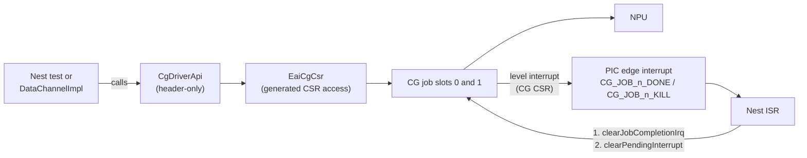
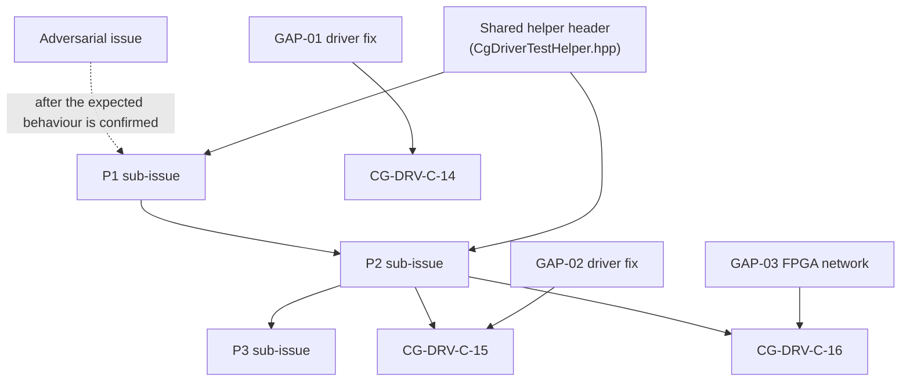

# EN2 CG Driver Test Plan

Test plan for the CG driver (`drivers/cg`, `CgDriverApi`) on EN2, driven from the Nest. The driver submits jobs to the CG job slots, relays job completion and kill, and reports status. This issue holds the plan. Candidate tests are tracked in sub-issues (P1, P2, P3) and an adversarial issue. Three gaps are tracked as separate dependent issues, each with its own blocked test. Two are driver gaps, and one is a test environment gap (real jobs run on Veloce only).

> **ID convention:** `CG-DRV-T-nn` = **T**est exists. `CG-DRV-C-nn` = **C**andidate driver test (not yet written). `CG-ADV-C-nn` = **C**andidate **adv**ersarial test (not yet written).

- [Objective](#objective)
- [Existing Tests](#existing-tests)
- [Recommended Test Additions](#recommended-test-additions)
- [Open questions](#open-questions)
- [Adversarial Tests](#adversarial-tests)

---

## Objective

### Purpose

Verify that `CgDriverApi` programs the EN2 CG job slots correctly and reports what the hardware did. The driver is header-only. It is compiled into the caller and writes the generated CG CSR (`eai::nriscv::EaiCgCsr`). The tests check job submission, completion, kill, the two interrupt layers, and the status and timestamp reads.

CG tests run **from the Nest only**. The CG RISC-V does not take part. CG is the engine that runs a network binary for the NPU, so a real job needs the NPU firmware and a network binary in LPDDR. A **loopback** job needs neither: CG completes it by itself.

### Driver users

The only production caller is `services/data-channel/src/DataChannelImpl.cpp`. It uses 15 of the 16 driver functions (all except `npuCount`). **No existing test calls `CgDriverApi`**: the three CG tests write `EaiCgCsr` directly (see [Existing Tests](#existing-tests)).

### Layers

There are two interrupt layers. The **level** interrupt in the CG CSR must be enabled to receive job done or killed (`enableJobInterrupts`). The **edge** interrupt to the PIC must be installed and enabled by the caller (`BspInterrupt::installVector`, `enableInterrupt`). The ISR clears the level interrupt first, then the edge.

### EN2 driver facts

| Item | EN2 |
|---|---|
| NPUs | 1. `npuCount()` returns 1. A `NpuIndex` other than 0 fails a `static_assert`, so it is a build error and not a runtime test. |
| Job slots | 2 (job 0 and job 1) |
| `JobControl` fields used | `mode`, `type`, `vfid`, `loopback`, `start` |
| `JobControl` fields ignored | `binLocation`, `checksum`, `addressRedirect` (the EN2 CSR has no such fields) |
| `enableJobInterrupts` | Clears, then enables, done and killed for job 0 and job 1 |
| `readJobResponse` | Decodes the job status into `RESERVED`, `COMPLETED`, `ERROR` or `ABEND` |
| `logDebugStatus` | Prints `CgDbgStatus` and `CgDbg2Status`. There is no getter. |
| Interrupt routing | One priority-table row per pair: `CG_JOB_0_DONE` and `CG_JOB_0_KILL` each have a count of 2, which covers job 1 as well |

### Gaps

GAP-01 and GAP-02 are driver gaps, found by reading the driver. Confirm each one. GAP-03 is a test environment gap.

| Gap | Summary | Issue | Blocked test |
|---|---|---|---|
| GAP-01 | `jobIndex` is not range-checked. `clearJobCompletionIrq`, `clearJobKill` and `requestJobKill` treat any non-zero index as job 1, and the indexed CSR accesses take the index as given. | #TBD | CG-DRV-C-14 |
| GAP-02 | The driver has no getter for CG state or abort reasons, only `logDebugStatus`, which prints. A test cannot assert `cg_state` or `sw_job_kill_abort` through the driver. | #TBD | CG-DRV-C-15 |
| GAP-03 | **Real jobs run on Veloce only.** `TestEn2CgExecution.cpp` is the only EN2 test that runs a real job, and it works only on Veloce. There is no FPGA-compatible network binary to run on CG. Every real-job test in this plan (P2, and C-13) inherits the limit until one exists. | #TBD | CG-DRV-C-16 |

### Platforms

| Test type | Veloce | FPGA |
|---|---|---|
| Loopback (P1, C-12, C-14, ADV-C-01, ADV-C-04) | Yes | To confirm (no network binary needed) |
| Real job, kill, recovery (P2, C-11, C-13, ADV-C-02, C-03, C-05) | Yes | **No**, until GAP-03 is closed |

### Build and run

- Nest executables are registered in `tests/device/en2/nest/CMakeLists.txt`. `cg-driver` is an `INTERFACE` library, so a test links it with `LIBS cg-driver`. The device directory is chosen by `IS_DEVICE_EN2`.
- **Loopback tests** (P1) need only the Nest. They run with no NPU image and no network binary.
- **Real-job tests** (P2, P3) run on **Veloce only** today (GAP-03). They need the NPU firmware loaded, a network binary in LPDDR (the existing EN2 test uses LPDDR offset `0x1000`), the NPU L3 region set with `writeFirmwareL3Region`, and the DDR base register populated (the existing test says "the testing scripts will populate this register").
- Tests use `TEST_F_CLEAN`.
- Run one CG ELF at a time. They share the CG job slots and interrupts.

---

## Existing Tests

Three Nest test sources exercise CG. **All three bypass `CgDriverApi` and write `EaiCgCsr` directly.** Only `TestCgInterrupts.cpp` and `TestEn2CgExecution.cpp` are built for EN2.

| Source | Executable | EN2 | EN1 | ArcoAI |
|---|---|---|---|---|
| `TestCgInterrupts.cpp` | `test-nest-cg-interrupts-bm.elf` | Built | Built | Commented out |
| `TestEn2CgExecution.cpp` | `test-nest-en2-cg-execution-bm.elf` | Built | n/a | n/a |
| `TestCgJobKill.cpp` | `test-nest-cg-job-kill.elf` | **Commented out** | Built (`LIBS mmu-driver test-binary`) | Commented out |

| ID | Test | Built for EN2 | What it checks |
|---|---|---|---|
| CG-DRV-T-01 | `CgNestInterrupts.Job0DoneLoopback` | Yes | Loopback job 0, vfid 3, tag `0xDEADBEEF`. One done interrupt, last-job tag matches, response `COMPLETED`, vfid 3, not busy. Waits 1000 loop iterations, not a time. |
| CG-DRV-T-02 | `CgNestInterrupts.Job1DoneLoopback` | Yes | Same on job 1. |
| CG-DRV-T-03 | `En2CgExecution.RunJob0DoneJob0` | Yes (**Veloce only**) | Real job 0 with a network binary: sequential, normal, vfid 0. Waits for the done interrupt. Response `COMPLETED`, not busy. Logs the duration in cycles and the CG debug status. Job 0 only. |
| CG-DRV-T-04 | `CgJobKill.RunJob0DoneJob0` | No | Runs the embedded hello-world program to completion. Records `jobDuration_`, which every later kill test uses as its timing base. |
| CG-DRV-T-05 | `CgJobKill.RunJob0KillJob0` | No | Kill running job 0 after 1000 cycles: no done interrupt, kill interrupt received. Then job 0 runs again and completes. |
| CG-DRV-T-06 | `CgJobKill.RunJob0KillJob0Job1` | No | Kill for jobs 0 and 1 while only job 0 runs. The kill of idle job 1 is ignored (no kill interrupt). |
| CG-DRV-T-07 | `CgJobKill.RunJob1KillJob1` | No | Kill running job 1. |
| CG-DRV-T-08 | `CgJobKill.RunJob1KillJob0Job1` | No | Kill for jobs 0 and 1 while only job 1 runs. The kill of idle job 0 is ignored. |
| CG-DRV-T-09 | `CgJobKill.RunJob0Job1KillJob0Job1` | No | Both jobs submitted, both killed: both kill interrupts, no done interrupt. |
| CG-DRV-T-10 | `CgJobKill.RunJob0Job1DoneJob0KillJob1` | No | Job 0 completes, then kill for both. The kill of finished job 0 is ignored, and job 1 is killed. |
| CG-DRV-T-11 | `CgJobKill.RunJob0Job1DoneJob1KillJob0` | No | Same with the roles swapped: the kill of finished job 1 is ignored, and job 0 is killed. |
| CG-DRV-T-12 | `CgJobKill.RunJob0Job1KillJob0` | No | Both jobs submitted, kill job 0 only. |
| CG-DRV-T-13 | `CgJobKill.RunJob0Job1KillJob1` | No | Both jobs submitted, kill job 1 only. |
| CG-DRV-T-14 | `CgJobKill.RunJob0Job1DoneJob0KillJob1Recovery` | No | As T-10, then checks `cg_state` is 7 (`E_CG_KILL_WAIT`) and resets the NPU to recover. |
| CG-DRV-T-15 | `CgJobKill.RunJob0Job1DoneJob1KillJob0Recovery` | No | As T-11, same recovery check. |

> **None of the 15 tests calls the driver.** They show what the hardware does at the CSR level, which is the evidence to port. They cover none of the driver code (see below).

### Why `TestCgJobKill.cpp` is not built for EN2

It was written for EN1. Likely blockers (not compiled to confirm):

- It sets `bin_loc` in the job control. The EN2 CSR has no such field, and `TestEn2CgExecution.cpp` leaves it out.
- It names the NPU L3 region with the `view::npu` tag. The EN2 test uses `memmap::l3::NpuComputeTag`.
- It loads the NPU program with `INCLUDE_PROGRAM` (`hello_world_print_message_full_model_npu.bin`, from `test-binary`). Check that a build exists for EN2.
- `resetNpu` carries the comment "EN1: L3 memory is not lost, no need to reload the NPU image". EN2 may need a reload.

### Coverage analysis (current tests)

**Metric.** Coverage = items exercised **through `CgDriverApi`** by at least one existing test ÷ total items. Items are the **16 driver functions** plus **21 behaviours**. Adversarial tests are not counted. Because no test calls the driver, **today is 0%**. The CSR-level evidence in the behaviour table below is what the P1 and P2 tests port.

| Item type | Total | Covered now | Coverage |
|---|---|---|---|
| Driver functions | 16 | 0 | 0.0% |
| Behaviours | 21 | 0 | 0.0% |
| **Total** | **37** | **0** | **0.0%** |

Driver functions: `npuCount`, `enableJobInterrupts`, `clearJobCompletionIrq`, `clearJobKill`, `writeScratchBase`, `writeBinaryAddress`, `writeJobTag`, `readJobTag`, `writeJobControl`, `requestJobKill`, `readJobResponse`, `isJobBusy`, `readJobStartTimestamp`, `readJobDoneTimestamp`, `readCurrentJobIndex`, `logDebugStatus`.

---

## Recommended Test Additions

### Sub-issues and coverage progression

| Issue | Candidate tests | Items closed | Gain | Coverage after |
|---|---|---|---|---|
| Today | n/a | n/a | n/a | 0.0% |
| **P1 sub-issue** (loopback jobs, interrupts, status) | CG-DRV-C-01 to C-04 | 14 | +37.8% | **37.8%** |
| **P2 sub-issue** (real jobs and kill, Veloce) | CG-DRV-C-05 to C-10 | 16 | +43.3% | **81.1%** |
| **P3 sub-issue** (recovery, control fields, modes) | CG-DRV-C-11 to C-13 | 4 | +10.8% | **91.9%** |
| GAP-01 (#TBD) | CG-DRV-C-14 | 1 | +2.7% | 94.6% |
| GAP-02 (#TBD) | CG-DRV-C-15 | 1 | +2.7% | 97.3% |
| GAP-03 (#TBD) | CG-DRV-C-16 | 1 | +2.7% | **100%** |
| **Adversarial** | CG-ADV-C-01 to C-05 | not counted | n/a | n/a (see [Adversarial Tests](#adversarial-tests)) |

### Candidate tests

P1, P2 and P3 tests can be written against the current driver. GAP tests are **blocked until the driver supports the capability**.

#### P1

**Loopback jobs, interrupt rules and status.** No NPU needed. Coverage after this group: 37.8%.

| ID | Candidate test | Executable | Items |
|---|---|---|---|
| CG-DRV-C-01 | Loopback job 0 and job 1 through the driver | **New:** `test-nest-cg-driver-bm.elf` (`TestCgDriver.cpp`) | 10 |
| CG-DRV-C-02 | Interrupt enable and clear rules | `test-nest-cg-driver-bm.elf` | 2 |
| CG-DRV-C-03 | vfid carried to job status | `test-nest-cg-driver-bm.elf` | 1 |
| CG-DRV-C-04 | Debug status log | `test-nest-cg-driver-bm.elf` | 1 |

#### P2

**Real jobs and kill.** Needs the NPU image and a network binary. **Runs on Veloce only** (GAP-03). Coverage after this group: 81.1%.

| ID | Candidate test | Executable | Items |
|---|---|---|---|
| CG-DRV-C-05 | Real job 0 through the driver | **New:** `test-nest-cg-driver-job-bm.elf` (`TestCgDriverJob.cpp`) | 6 |
| CG-DRV-C-06 | Real job 1 | `test-nest-cg-driver-job-bm.elf` | 1 |
| CG-DRV-C-07 | Busy and current-job tracking | `test-nest-cg-driver-job-bm.elf` | 2 |
| CG-DRV-C-08 | Two jobs back to back | `test-nest-cg-driver-job-bm.elf` | 1 |
| CG-DRV-C-09 | Kill a running job, then resubmit | `test-nest-cg-driver-job-bm.elf` | 4 |
| CG-DRV-C-10 | Kill ignored for idle or finished job, kill both | `test-nest-cg-driver-job-bm.elf` | 2 |

#### P3

**Recovery, control fields and modes.** C-11 and C-13 run on Veloce only (GAP-03). Coverage after this group: 91.9%.

| ID | Candidate test | Executable | Items |
|---|---|---|---|
| CG-DRV-C-11 | Kill lockup recovery | **New:** `test-nest-cg-driver-recovery-bm.elf` (`TestCgDriverRecovery.cpp`) | 1 |
| CG-DRV-C-12 | `writeJobControl` field handling | `test-nest-cg-driver-bm.elf` | 2 |
| CG-DRV-C-13 | `JobType` and `JobMode` variations | `test-nest-cg-driver-job-bm.elf` | 1 |

#### GAP-01 (blocked)

**Blocked until the driver validates `jobIndex`.** Coverage after this test: 94.6%.

| ID | Candidate test | Executable | Items |
|---|---|---|---|
| CG-DRV-C-14 | Job index above 1 is rejected | `test-nest-cg-driver-bm.elf` | 1 |

#### GAP-02 (blocked)

**Blocked until the driver can read CG state.** Coverage after this test: 97.3%.

| ID | Candidate test | Executable | Items |
|---|---|---|---|
| CG-DRV-C-15 | CG state and abort reasons read through the driver | `test-nest-cg-driver-recovery-bm.elf` | 1 |

#### GAP-03 (blocked)

**Blocked until an FPGA-compatible network binary exists.** Coverage after this test: 100%.

| ID | Candidate test | Executable | Items |
|---|---|---|---|
| CG-DRV-C-16 | Real job 0 through the driver on FPGA | `test-nest-cg-driver-job-bm.elf` (C-05 run on FPGA with the FPGA network) | 1 |

Details, notes and definition of done are in each sub-issue and gap issue.

### Behaviours and where they are seen

"Seen at the CSR level" is existing evidence from tests that bypass the driver. It is **not counted** as coverage.

| # | Behaviour | Seen at the CSR level | Covered through the driver by |
|---|---|---|---|
| 1 | Loopback job 0 completes: done interrupt, `COMPLETED`, tag, vfid, not busy | T-01 | C-01 |
| 2 | Loopback job 1 completes | T-02 | C-01 |
| 3 | vfid carried to job status (several values) | T-01, T-02 (vfid 3 only) | C-03 |
| 4 | `clearJobCompletionIrq` clears one slot only | none | C-02 |
| 5 | `enableJobInterrupts` clears a stale interrupt before enabling | none | C-02 |
| 6 | Real job 0 completes | T-03, T-04 (T-04 is EN1 only) | C-05 |
| 7 | Real job 1 completes | T-07 to T-13 (EN1 only) | C-06 |
| 8 | Start and done timestamps are consistent | none (tests time the job with core cycle counters) | C-05 |
| 9 | `isJobBusy` and `readCurrentJobIndex` track the running slot | T-05 to T-13 read busy (EN1 only); none read the current job | C-07 |
| 10 | Two jobs submitted back to back complete in order | T-10, T-11 (EN1 only) | C-08 |
| 11 | Kill of a running job: kill interrupt, no done interrupt (job 0 and job 1) | T-05, T-07 (EN1 only) | C-09 |
| 12 | Kill of an idle or finished job is ignored | T-06, T-08, T-10, T-11 (EN1 only) | C-10 |
| 13 | Kill of both jobs | T-09 (EN1 only) | C-10 |
| 14 | A killed job can be resubmitted and completes | T-05 to T-08 (EN1 only) | C-09 |
| 15 | Kill lockup recovery (`cg_state` 7, NPU reset) | T-14, T-15 (EN1 only) | C-11 |
| 16 | EN2 ignores `binLocation`, `checksum` and `addressRedirect` | none | C-12 |
| 17 | `JobType` `LOAD_ONLY` and `EXEC_ONLY`, and `JobMode` `PARALLEL` | none | C-13 |
| 18 | Job index above 1 is rejected | none | C-14 (GAP-01) |
| 19 | CG state and abort reasons readable through the driver | none | C-15 (GAP-02) |
| 20 | `start = false` programs the slot without launching | none | C-12 |
| 21 | Real job runs on FPGA (FPGA-compatible network) | none (T-03 is Veloce only) | C-16 (GAP-03) |

### Dependency order

### Test hygiene

- **Share the helper code.** `TestCgInterrupts.cpp`, `TestEn2CgExecution.cpp` and `TestCgJobKill.cpp` each carry their own ISRs, submit code and wait loops. Move them into one header, `tests/nest/nest-unit-tests-bm/src/CgDriverTestHelper.hpp`, written on `CgDriverApi`.
- **Use time, not loop counts, for waits.** T-01 and T-02 wait 1000 loop iterations. Use a cycle-count timeout (`BspPerformanceCounters::mCycles32`), as the kill tests do.
- **Do not depend on test order.** In `TestCgJobKill.cpp`, `jobDuration_` is a static set only by `RunJob0DoneJob0`. Every other case uses it as its timing base, so a single case run alone gets 0. Measure it in `setUp`, or in a fixture-level run, for the new tests.
- **Tear down.** The existing fixtures install ISRs and enable interrupts in `setUp` and never undo it. Add a `tearDown` that disables the level and edge interrupts and calls `clearJobCompletionIrq` and `clearJobKill` for both slots.
- **Clear the kill bit.** A kill that is not cleared with `clearJobKill` can affect the next job on that slot. Clear it in the test, not the next `setUp`.
- **Clear the interrupt in the right order.** The ISR calls `clearJobCompletionIrq` (level) first, then `BspInterrupt::clearPendingInterrupt` (edge).
- **Two tag reads.** `readJobTag(jobIndex)` reads the per-slot tag the driver wrote. The existing interrupt test reads `readCgLastJobTag`, a different register. Test both: the first in C-01, the second as a CSR cross-check.
- **Reset after a lockup.** Use the NPU reset as `TestCgJobKill.cpp` does. The comment says L3 survives it on EN1. Check whether the NPU image must be reloaded on EN2.

---

## Open questions

- **Three tests, not two.** The brief names `TestCgInterrupts` and `TestCgJobKill`. `TestEn2CgExecution.cpp` also exists, and it is the only CG test that runs a real job on EN2. Confirm that it counts as a CG test.
- **Driver use.** The brief says the CG tests use the driver. None of them calls `CgDriverApi`. Confirm whether a port is the intent (the plan assumes it is), or whether the tests are meant to stay at the CSR level.
- **Why `TestCgJobKill.cpp` is off on EN2.** Confirm whether it is the build blockers above, or something about EN2 hardware (kill behaviour, NPU reset).
- **Loopback and the NPU.** Confirm that a loopback job needs no NPU firmware or image. `TestCgInterrupts.cpp` sets none up.
- **`JobType` and `JobMode` semantics.** `LOAD_ONLY`, `EXEC_ONLY` and `PARALLEL` are never exercised. C-13 needs the CG design behaviour for each before it can assert anything.
- **Timestamp registers.** Confirm the unit and the reference of `readJobStartTimestamp` and `readJobDoneTimestamp` (CG clock cycles, or the Nest counter), because C-05 compares them with a Nest cycle count.
- **What makes the network Veloce-only.** Confirm why the current network binary does not run on FPGA (size, clock or timing assumptions, memory map, or a missing block), so GAP-03 states what the FPGA network must satisfy. Also confirm whether the loopback tests run on FPGA.
- **Generated CSR header.** `eai_cg_csr_nriscv.hpp` is generated and is not in the repository tree. C-12 reads CSR registers back, so confirm the accessor names in the generated header.

---

## Adversarial Tests

Tracked in a separate issue: [EN2 CG Driver: Adversarial Tests](#TBD). These tests drive the CG into unusual states on purpose and check that the driver reports them and that CG recovers. They check hardware behaviour seen through the driver, so they are **not counted** in the 37-item metric.

| ID | Test | Fault injected | Expected |
|---|---|---|---|
| CG-ADV-C-01 | `MaskedInterrupt` | Loopback job with the level interrupt disabled | No ISR; response `COMPLETED`; the interrupt fires when enabled (to confirm) |
| CG-ADV-C-02 | `StaleKillBit` | `requestJobKill` on an idle slot, no `clearJobKill`, then submit | To confirm: job is killed or the kill is ignored |
| CG-ADV-C-03 | `BadBinaryAddress` | Binary address that is not mapped | Response `ERROR` (or `ABEND`); `axi_err_rsp_abort` set; Nest responsive |
| CG-ADV-C-04 | `BadJobIndex` | Job index 2 to `clearJobCompletionIrq`, `clearJobKill`, `requestJobKill`, `readJobResponse` | Today index 2 acts as job 1 in the first three; record the result. Related to GAP-01 |
| CG-ADV-C-05 | `SubmitWhileBusy` | `writeJobControl` with `start` on a slot that is already running | To confirm: rejected, queued or corrupts the running job |

CG-ADV-C-03 relates to the MMU adversarial tests and shares their hazard: an access to unmapped memory may wedge the bus rather than return an error. Resolve that first. CG-ADV-C-02 and C-05 need the expected behaviour from the CG design before they can assert it.
