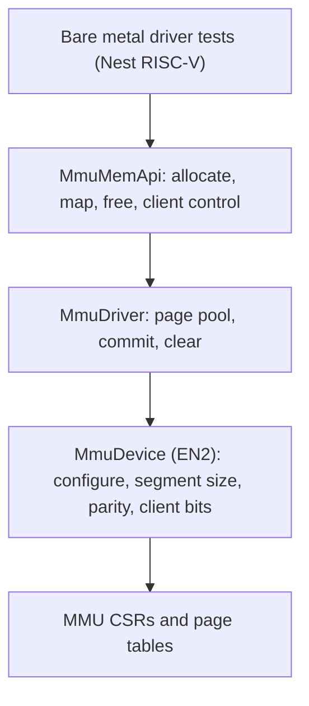
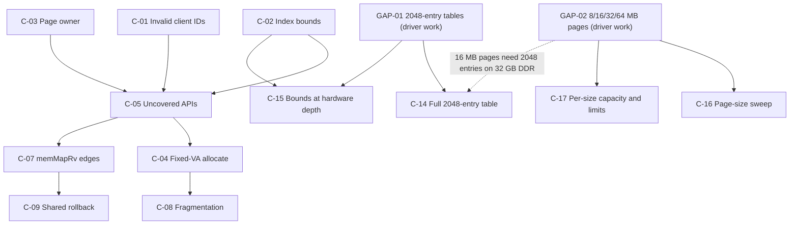
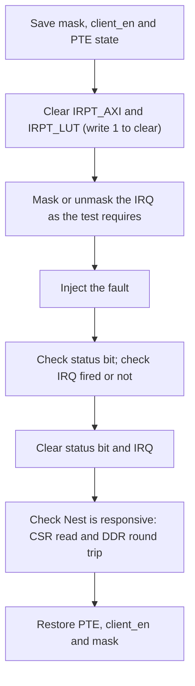

# EN2 MMU Test Plan

Test plan for the EN2 MMU driver (`drivers/mmu`) bare-metal tests. This issue holds the plan. Candidate tests are tracked in sub-issues (P1, P2, P3). Two driver gaps are tracked as separate dependent issues, each with its own blocked tests.

> **ID convention:** `MMU-DRV-T-nn` = **T**est exists. `MMU-DRV-C-nn` = **C**andidate driver test (not yet written). `MMU-ADV-C-nn` = **C**andidate **adv**ersarial test (not yet written).

- [Objective](#Objective)
- [Bare Metal Driver Tests](#bare-metal-driver-tests)
- [Recommended Test Additions](#recommended-test-additions)
- [Adversarial Tests](#adversarial-tests)

---

## Objective

### Purpose

Verify the EN2 MMU driver (`MmuMemApi` / `MmuDriver`, with the EN2 device layer) with bare-metal tests built for EN2, and identify gaps against the capabilities of the driver **and of the hardware**.

### EN2 configuration: hardware vs driver

| Item | Hardware supports | Driver supports today | Source |
|---|---|---|---|
| Page-table entries per client | 2048 | 1024 | `PAGE_TABLE_ENTRY_MMU_TABLE_RANGE_SIZE`; driver limits in `MmuDriver.cpp`, `MmuMemApi.cpp` |
| Page (segment) size | 8, 16, 32, 64 MB (`xlat_seg_size`) | 32 MB only | `static_assert(CONFIG_SYSTEM_MMU_PAGE_SIZE_MB == 32)` in `MmuDeviceEn2.cpp` |
| Client tables | 10: PF = 0, VF0..VF7 = 1..8, RISCV = 9 | Same | [MemClient.hpp](../firmware/drivers/common/include/MemClient.hpp) |
| Pages per table, production / FPGA | n/a | 1024 (32 GB) / 128 (4 GB) | `CONFIG_SYSTEM_DDR_SIZE_MB` / `CONFIG_SYSTEM_DDR_REDUCED_SIZE_MB` in [system.yaml](../firmware/cmake/fw-config/defaults/system.yaml) |
| RISC-V pages per table | n/a | up to 64 | `CONFIG_SYSTEM_MMU_MAX_PAGES_RV` |

> Naming: the `MemClient` enum uses `VF0..VF7`. [drivers/mmu/README.md](../firmware/drivers/mmu/README.md) uses `VF1..VF8`. This document uses the enum names.

### Driver gaps against the hardware

| Gap | Issue | Evidence | Blocked tests |
|---|---|---|---|
| **GAP-01:** driver cannot use the upper 1024 of the 2048 table entries | #TBD | `PageTableResourceRecord::index : 10` and `static_assert(CONFIG_SYSTEM_MMU_MAX_PAGES_PER_TABLE <= 1024)` in `MmuDriver.cpp`; `MemAllocRecord::clientStartPageIndex_bits = 10` and `numPages_bits = 11` in `MmuMemApi.cpp` | MMU-DRV-C-14, C-15 |
| **GAP-02:** driver supports only 32 MB pages | #TBD | `static_assert(CONFIG_SYSTEM_MMU_PAGE_SIZE_MB == 32)` in `MmuDeviceEn2::configure()`; page size is a compile-time constant in `MmuDriver::pageSizeBytes()` and `MmuMemApi::getPageSize()` | MMU-DRV-C-16, C-17 |

The gaps interact. With 2048 entries the table reaches 16 GB at 8 MB pages, 32 GB at 16 MB, 64 GB at 32 MB, and 128 GB at 64 MB. On a 32 GB DDR platform, 16 MB pages need all 2048 entries, and 8 MB pages cannot cover the DDR.

### Layers

### Build and run

- EN2 MMU ELFs are registered inside `if(ENABLE_EXTRA_METAL)` in [tests/device/en2/nest/CMakeLists.txt](../firmware/tests/device/en2/nest/CMakeLists.txt). They are not built by default.
- Each ELF is a separate target with no `-clean` variant, so every enabled test runs.
- Tests run from RVSRAM (`nest_rvsram_test.lds`).

| ELF | Source | Driver tests |
|---|---|---|
| `test-nest-mmu-driver-bm.elf` | `TestMmuDriver.cpp` (`MmuDriver` level) | 7 |
| `test-nest-mmu-bm.elf` | `TestMmuEn2.cpp` (`MmuMemApi` level; also holds 8 HW tests, not listed here) | 18 |

---

## Bare Metal Driver Tests

### API coverage

"No test" means no test calls the function directly. Some are reached only indirectly.

| Area | Functions | Direct test coverage |
|---|---|---|
| Allocation | `allocate(bytes, client)`, `allocateRv`, `allocateRvShared`, `free(handle)`, `free(va, client)` | Covered |
| Allocation (fixed VA) | `allocate(bytes, client, va)` | Not tested (MMU-DRV-C-04) |
| Mapping | `memMapRv` (handle), `memUnmapRv` | Covered |
| Mapping | `memMapRv` (client, VA) | Not tested (MMU-DRV-C-07) |
| Client free | `freeClient` | Not tested (MMU-DRV-C-05) |
| Client control | `enable`, `disable`, `enableClient`, translation and cache enable | Covered |
| Client control | `MmuMemApi::disableClient`, `isClientEnabled`, `isClientTranslationEnabled`, `isClientTranslationCacheEnabled` | Not tested (MMU-DRV-C-05) |
| Queries | `getTotalNumPages`, `getNumFreePages`, `getNumFreeAllocationRecords`, `getPageSize` | Covered |
| Queries | `getClientNumAllocatedPages`, `getClientAllocatedPages`, `getNumFreeRvMemMapRecords`, `getNumPages` | Not tested (MMU-DRV-C-05) |
| Clear | `MmuMemApi::clearClientPages` | Not tested (MMU-DRV-C-05); `MmuDriver::clearClientPages` covered |
| `MmuDriver` | `MmuDriver::disable`, `MmuDriver::getNumPages` | Not tested (MMU-DRV-C-05) |
| Owner | `MmuDriver::getPageOwner` | Called, owner value not checked (MMU-DRV-C-03) |
| Init | `MmuDriver::init` | Covered for first call only (MMU-DRV-C-10) |
| Page size | 8, 16, 64 MB | Not supported by driver (GAP-02, MMU-DRV-C-16, C-17) |
| Table depth | Entries 1024..2047 | Not supported by driver (GAP-01, MMU-DRV-C-14, C-15) |

### `test-nest-mmu-driver-bm` (`TestMmuDriver.cpp`)

| ID | Test | What it checks |
|---|---|---|
| MMU-DRV-T-01 | `InitAndQueries` | `init(0)` is idempotent; totals are sane; page size is 32 MB; RV, PF and VF1 entries clear after init. |
| MMU-DRV-T-02 | `AllocateSpanUniquePages` | Span allocation returns unique in-range pages; free count drops and is restored. |
| MMU-DRV-T-03 | `CommitSpanReadback` | Committed VF1 pages read back valid, writable, with the right page number. |
| MMU-DRV-T-04 | `CommitSpanReadbackRejected` | Mismatched span lengths and re-committing a valid page are rejected. |
| MMU-DRV-T-05 | `ClearAndFreePages` | Clear removes PTEs but keeps physical pages allocated; free restores the count. |
| MMU-DRV-T-06 | `ClientControl` | Per-client enable, translation and cache change only the target client (or globally when `supportsPer*` is false). |
| MMU-DRV-T-07 | `Client9VirtualMemoryAccess` | Four RISC-V pages are reachable by VA with distinct signatures (no aliasing). |

### `test-nest-mmu-bm` driver group (`TestMmuEn2.cpp`)

| ID | Test | What it checks |
|---|---|---|
| MMU-DRV-T-08 | `DriverFreeByAddress` | Two 32 MB VF1 allocations; first at VA 0; free by (VA, client). |
| MMU-DRV-T-09 | `DriverCheckFreePagesRiscV` | One RISC-V page allocate and free; free count at each step. |
| MMU-DRV-T-10 | `DriverAllocAllPagesRiscV` | Allocates the full RISC-V record capacity; free count restored. |
| MMU-DRV-T-11 | `DriverAllPagesInOneAllocationClientVF0` | One allocation of all DRAM for VF0; further allocations fail for VF0 and VF1. |
| MMU-DRV-T-12 | `DriverAllocSharedRv` | 16-page shared allocation; RV and every VF table map the same physical pages at the shared VA; free restores all. |
| MMU-DRV-T-13 | `DriverAllocSharedRvInvalid` | 17-page shared allocation fails and leaks nothing. |
| MMU-DRV-T-14 | `DriverMemMapPfAndRvValidatePages` | 2-page PF allocation mapped into RISC-V; both physical pages present; unmap and free. |
| MMU-DRV-T-15 | `DriverMemMapPfAndRvMaxSingle` | 32 single-page PF allocations, each mapped into RISC-V. |
| MMU-DRV-T-16 | `DriverMemMapPfAndRvOffset` | Valid offset and size combinations map the expected pages; invalid ones fail. |
| MMU-DRV-T-17 | `DriverAllPagesInOnePagePerAllocationClientVF0` | Every page allocated one at a time for VF0; one more fails. |
| MMU-DRV-T-18 | `DriverAllocRegionAndCheckAddressClientVF0` | Two 32 MB VF0 allocations get distinct non-zero addresses. |
| MMU-DRV-T-19 | `DriverAllocRegionAndCheckAddressClientVF1` | Two 64 MB VF1 allocations get distinct non-zero addresses. |
| MMU-DRV-T-20 | `DriverCheckPageSizeAndFreePages` | Page size equals the config value; one-page allocate and free adjust the count. |
| MMU-DRV-T-21 | `DriverCheckFailedMultiBlockAllocation` | With 2 pages free, a 4-page request fails without changing the count. |
| MMU-DRV-T-22 | `DriverAllocAndFreeOnePageAllClients` | One page for each of PF and VF0..VF7; each freed by handle. |
| MMU-DRV-T-23 | `DriverFreeWithInvalidHandle` | `free(0xFFFF)` fails; the real handle still frees. |
| MMU-DRV-T-24 | `DriverFreeWithInvalidClenId` | Free by VA with the wrong client fails; the right client succeeds. |
| MMU-DRV-T-25 | `DriverFreeUnallocatedAddress` | Free just past the allocation fails; the real address still frees. |

---

## Recommended Test Additions

### Coverage analysis (current tests)

**Metric.** Coverage = items exercised by at least one EN2 test ÷ total items. Items are the **59 public API functions** (32 `MmuMemApi`, 27 `MmuDriver`; overloads counted separately) plus **28 driver behaviours** (error paths, boundaries, state rules, and the hardware capabilities the driver does not yet support). `getPageOwner` is called but its value is never checked, so it is not counted.

| Item type | Total | Covered now | Coverage |
|---|---|---|---|
| API functions | 59 | 45 | 76.3% |
| Behaviours | 28 | 8 | 28.6% |
| **Total** | **87** | **53** | **60.9%** |

### Sub-issues and coverage progression

| Issue | Candidate tests | Items closed | Gain | Coverage after |
|---|---|---|---|---|
| Today | n/a | n/a | n/a | 60.9% |
| **P1 sub-issue** | MMU-DRV-C-01 to C-05 | 17 | +19.5% | **80.5%** |
| **P2 sub-issue** | MMU-DRV-C-06 to C-11 | 9 | +10.3% | **90.8%** |
| **P3 sub-issue** | MMU-DRV-C-12, C-13 | 2 | +2.3% | **93.1%** |
| **GAP-01** (2048-entry tables) | MMU-DRV-C-14, C-15 | 2 | +2.3% | **95.4%** |
| **GAP-02** (8/16/32/64 MB pages) | MMU-DRV-C-16, C-17 | 4 | +4.6% | **100%** |
| **Adversarial** ([#4043](https://github.com/EnChargeAI/EAI_Firmware/issues/4043)) | MMU-ADV-C-01 to C-05 | not counted | n/a | n/a (hardware fault reporting, see [Adversarial Tests](#adversarial-tests)) |

### Candidate tests

P1, P2 and P3 tests can be written against the current driver. GAP tests are **blocked until the driver supports the capability**.

#### P1

**Driver capability not covered by any test, or a suspected defect.** Coverage after this group: 80.5%.

| ID | Candidate test | Executable |
|---|---|---|
| MMU-DRV-C-01 | Invalid client IDs | `test-nest-mmu-driver-bm.elf` and `test-nest-mmu-bm.elf` |
| MMU-DRV-C-02 | Index bounds | `test-nest-mmu-driver-bm.elf` |
| MMU-DRV-C-03 | Page owner | `test-nest-mmu-driver-bm.elf` |
| MMU-DRV-C-04 | Fixed-VA allocate | `test-nest-mmu-bm.elf` |
| MMU-DRV-C-05 | Uncovered APIs | `test-nest-mmu-bm.elf` and `test-nest-mmu-driver-bm.elf` |

#### P2

**Important robustness tests.** Coverage after this group: 90.8%.

| ID | Candidate test | Executable |
|---|---|---|
| MMU-DRV-C-06 | Size edges | `test-nest-mmu-bm.elf` |
| MMU-DRV-C-07 | `memMapRv` edges | `test-nest-mmu-bm.elf` |
| MMU-DRV-C-08 | Fragmentation | `test-nest-mmu-bm.elf` |
| MMU-DRV-C-09 | Shared allocation rollback | `test-nest-mmu-bm.elf` |
| MMU-DRV-C-10 | `init` edges | New: `test-nest-mmu-init-bm.elf` |
| MMU-DRV-C-11 | Thread safety | New: `test-nest-mmu-mt-bm.elf` |

#### P3

**Nice-to-have tests.** Coverage after this group: 93.1%.

| ID | Candidate test | Executable |
|---|---|---|
| MMU-DRV-C-12 | Enable and disable semantics | `test-nest-mmu-driver-bm.elf` |
| MMU-DRV-C-13 | Soak | New: `test-nest-mmu-soak-bm.elf` |

#### GAP-01 (blocked)

**Blocked until the driver supports 2048-entry page tables.** Coverage after these tests: 95.4%.

| ID | Candidate test | Executable |
|---|---|---|
| MMU-DRV-C-14 | Full 2048-entry table | `test-nest-mmu-driver-bm.elf` and `test-nest-mmu-bm.elf` |
| MMU-DRV-C-15 | Index bounds at hardware depth | `test-nest-mmu-driver-bm.elf` |

#### GAP-02 (blocked)

**Blocked until the driver supports 8, 16, 32 and 64 MB pages.** Coverage after these tests: 100%.

| ID | Candidate test | Executable |
|---|---|---|
| MMU-DRV-C-16 | Page-size sweep (8, 16, 32, 64 MB) | `test-nest-mmu-bm.elf` (one build per size, or one ELF if size becomes runtime) |
| MMU-DRV-C-17 | Per-size capacity and limits | `test-nest-mmu-bm.elf` (same builds as C-16) |

Details, notes and definition of done are in each sub-issue and gap issue.

### Behaviours and where they are covered

| # | Behaviour | Covered by |
|---|---|---|
| 1 | Free rejects invalid handle, wrong client, unallocated VA | MMU-DRV-T-23, T-24, T-25 |
| 2 | Over-capacity allocation fails, state unchanged | MMU-DRV-T-11, T-17, T-21 |
| 3 | Commit rejects mismatched spans and already-valid pages | MMU-DRV-T-04 |
| 4 | Shared allocation rejects more than 16 pages | MMU-DRV-T-13 |
| 5 | `memMapRv` offset and size validation | MMU-DRV-T-16 |
| 6 | Per-client enable, translation, cache isolation | MMU-DRV-T-06 |
| 7 | `init` idempotent for the same start page | MMU-DRV-T-01 |
| 8 | Alloc and free restore page and record counts | MMU-DRV-T-02, T-05, T-09, T-10, T-20 |
| 9 | Invalid client id (10, 255) rejected on all APIs | **Gap**, MMU-DRV-C-01 |
| 10 | Page index at `total` rejected | **Gap**, MMU-DRV-C-02 |
| 11 | Page owner reported correctly | **Gap**, MMU-DRV-C-03 |
| 12 | Fixed-VA placement and validation | **Gap**, MMU-DRV-C-04 |
| 13 | Zero-size and overflow requests rejected | **Gap**, MMU-DRV-C-06 |
| 14 | Small-allocation (16 pages) vs heap (17 pages) boundary | **Gap**, MMU-DRV-C-06 |
| 15 | `memMapRv` rejects second mapping, record exhaustion, bad unmap | **Gap**, MMU-DRV-C-07 |
| 16 | Double free; free with an active RV mapping | **Gap**, MMU-DRV-C-07 |
| 17 | Contiguous failure with enough total free pages | **Gap**, MMU-DRV-C-08 |
| 18 | Shared allocation rolls back on partial conflict | **Gap**, MMU-DRV-C-09 |
| 19 | `init`: start page mismatch, range, preserved RV entries, boot-param path | **Gap**, MMU-DRV-C-10 |
| 20 | Concurrent allocate and free is correct | **Gap**, MMU-DRV-C-11 |
| 21 | `enable()` / `disable()` RISC-V bit semantics | **Gap**, MMU-DRV-C-12 |
| 22 | Random sequences leak-free against a model | **Gap**, MMU-DRV-C-13 |
| 23 | Table entries 1024..2047 usable | **Blocked by GAP-01**, MMU-DRV-C-14 |
| 24 | Index bound enforced at hardware depth (2048) | **Blocked by GAP-01**, MMU-DRV-C-15 |
| 25 | 8 MB pages work end to end | **Blocked by GAP-02**, MMU-DRV-C-16 |
| 26 | 16 MB pages work end to end | **Blocked by GAP-02**, MMU-DRV-C-16 |
| 27 | 64 MB pages work end to end | **Blocked by GAP-02**, MMU-DRV-C-16 |
| 28 | Pool size, RV window, rounding and offsets scale with page size | **Blocked by GAP-02**, MMU-DRV-C-17 |

### Dependency order

### Test hygiene

- **`MMU-DRV-T-17`** uses a `uint8_t` loop index against `getNumPagesPerSystem()`. With 1024 pages the index wraps at 256 and the loop never ends. It is only correct at 128 pages (FPGA). *To confirm on a production-sized build.*
- **Early returns skip cleanup.** For example, a failed allocation in `SegmentSizeSweep` returns without restoring state. Make cleanup unconditional.
- **Test name typo:** `DriverFreeWithInvalidClenId` should read `ClientId` (MMU-DRV-T-24).
- **README drift:** [drivers/mmu/README.md](../firmware/drivers/mmu/README.md) describes a class-style `MmuMemApi::instance()` API that does not match the namespace API in [MmuMemApi.hpp](../firmware/drivers/mmu/api/MmuMemApi.hpp), and its client naming (VF1..VF8) differs from the `MemClient` enum.
- **Unused legacy header:** `drivers/mmu/include/PageTableDescriptor.hpp` has a 10-bit `frameNumber` and no users. Remove it, or update it with GAP-01.
- **No aggregated suite:** the EN2 MMU ELFs are separate targets. Consider one `test-nest-mmu-suite` for CI.

---

## Adversarial Tests

Tracked in [#4043](https://github.com/EnChargeAI/EAI_Firmware/issues/4043).

### Purpose

Show that the MMU fails safely when software or a bus master makes an illegal access, and that it reports the fault. The five tests cover an unmapped VA, a write to a read-only page, a disabled client, a bad APB access, and the effect of interrupt masking. No test exists for any of these today.

These tests check hardware fault reporting. The driver does not read `IRPT_AXI` / `IRPT_LUT` and always sets `write_en`, so they add no driver API items and are **not counted in the 87-item driver metric** above.

### Executable

New ELF **`test-mmu-bounds-adversarial-bm.elf`**, named in #4043. The other EN2 MMU ELFs use the `test-nest-*-bm.elf` form, so confirm whether to rename it.

- Suggested source: `tests/nest/nest-unit-tests-bm/src/TestMmuBoundsAdversarial.cpp`.
- Register it in [tests/device/en2/nest/CMakeLists.txt](../firmware/tests/device/en2/nest/CMakeLists.txt) inside `if(ENABLE_EXTRA_METAL)`:
  `add_test_suite(ELF test-mmu-bounds-adversarial-bm.elf SOURCES "${TEST_NEST_BM_PATH}/src/TestMmuBoundsAdversarial.cpp" LIBS mmu-driver mmu-driver-test-interface)`

### Tests

| ID | Test | Fault injected | Expected | Cleanup |
|---|---|---|---|---|
| MMU-ADV-C-01 | `UnmappedVa` | With `xlat_en` on, access a VA whose PTE has `valid = 0` | AXI `buserr` status set; IRQ if unmasked; Nest still responsive afterwards | Clear the error and the IRQ |
| MMU-ADV-C-02 | `Modify0Write` | Commit a PTE with `valid = 1` and `Modify` / `write_en = 0`, then write through that VA | AXI `buserr` status set; IRQ if unmasked | Clear the error; restore the PTE |
| MMU-ADV-C-03 | `DisabledClientEn` | Use a spare IID (not the Nest RISC-V). Set `client_en` off and `xlat_en` on, then generate traffic for that IID | AXI `buserr` status set; IRQ if unmasked | Clear the error; restore `client_en`. If IID 9 is used, do not disable it after the test |
| MMU-ADV-C-04 | `ApbPslverr` | First assert `IRPT_AXI.pslverr` is clear and unmask the `pslverr` IRQ. From the Nest RISC-V, issue an APB access in the MMU CSR/TBL range that asserts `PSLVERR` (for example, read an unimplemented CSR) | `IRPT_AXI.pslverr` set | Clear the bit; restore the initial mask state |
| MMU-ADV-C-05 | `IrqMaskedVsUnmasked` | Generate an AXI fault with the `UnmappedVa` or `Modify0Write` method, once with the interrupt masked and once unmasked | `buserr` status bit set in both cases; IRQ fires only when unmasked | As for the method used |

### Common structure

### Notes and open questions

- **Possible conflict with existing observations.** `TestMmuEn2.cpp` (`SegmentIndexSweep`, `TwoSegmentAperture`) and `TestNestDmacMmuNpu.cpp` state that an access to an unmapped segment "returns no error and wedges the bus". C-01 expects a `buserr` and a responsive Nest. Either the hardware behaviour has changed, or the earlier case was different (for example, a valid entry that points beyond the DRAM window). Resolve this before writing C-01. If the bus still wedges, raise a hardware issue instead.
- **Protect the Nest.** The Nest RISC-V is the RISC-V client (IID 9). Keep test code and stack in RVSRAM, and fault only a VA window that holds neither. Run under a watchdog or a timeout so a wedged bus ends the run instead of hanging it.
- **C-03 needs a second bus master.** A spare IID means NPU DMAC traffic, as in `test-nest-dmac-mmu-npu-bm.elf` with its NPU stub. The DMAC result structure can report the AXI error.
- **IRQ support exists.** The EN2 Nest interrupt table has `MMU_BUS_ERROR` and `MMU_PAGE_TABLE_ERROR` in `BspPlatformInterruptPriorityEn2Nest.cpp`. Confirm which register each one reflects (presumably `IRPT_AXI` and `IRPT_LUT`). `TestCgInterrupts.cpp` and `TestDummyInterrupt.cpp` show the handler pattern.
- **Register field names.** `buserr` and `pslverr` come from #4043. Confirm the exact field names and mask registers against the EN2 MMU CSR map.
- **Ordering.** Run C-01 first because it carries the highest risk. C-05 reuses the C-01 and C-02 injection code.
