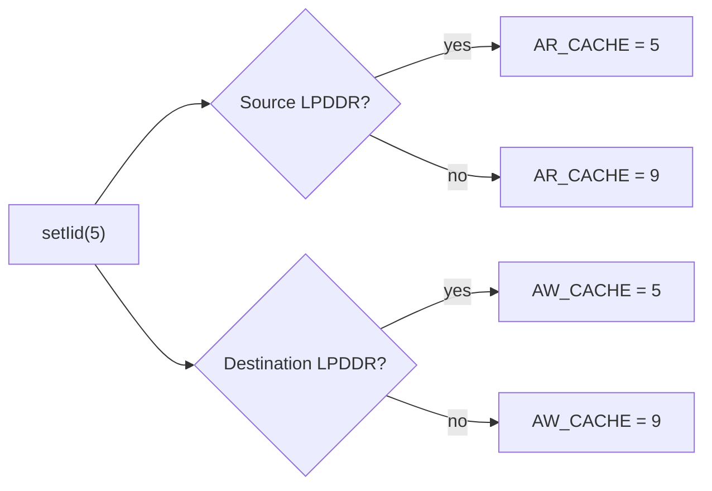

# EN2 Nest and NPU DMAC with MMU: DMAC-MMU-C-04 Id Rules

Parent issue: #TBD (EN2 Nest and NPU DMAC with MMU Test Plan). Group: P1 sub-issue #TBD.

> **ID convention:** `DMAC-MMU-C-nn` = **C**andidate test (to be written).

| | |
|---|---|
| Runs on | Nest |
| Executable | `test-nest-dmac-mmu-bm.elf` (existing) |
| Source | `tests/common/test-bm/TestDmacMmu.cpp`, as two new `TEST_F_CLEAN` cases in `DmacMmuFixture`: `NoIdNamed` and `IdIgnoredForNonDdr`. No CMake change. |
| Items closed | 2: behaviour 19 (translation on, no id named) and behaviour 20 (id ignored for non-DDR regions) |
| Coverage | If P1 is done in order (after C-01 to C-03): 69.5% to **72.9%** (+3.4%). Final P1 figure is 74.6%. |

## Goal

Pin down the two id rules. When no id is named, the transfer uses the default id 9, the RISC-V client. And the id is ignored when neither end of the transfer is LPDDR.

## Background

- `applyIid` writes the id into `AR_CACHE` only when the **source** is LPDDR, and into `AW_CACHE` only when the **destination** is LPDDR. Otherwise the field keeps its default, 9.
- `processCtl` sets both fields to 9 (`DmacEngine::processCtl`). Client 9 is the RISC-V client, which `MmuMemApi::enable()` leaves untranslated.
- `init` clears the id on both descriptor types. T-04 already checks that.

## Fixture additions

| Addition | Purpose |
|---|---|
| `ctlOf(const DmacLLHWDesc *)` | Returns `eai::nriscv::DmacChannel::CH_CTLStruct` built from `CHx_CTL_hi` and `CHx_CTL_lo`. Shared with C-01. |
| `dccmBuf_` (256 B) | A DCCM buffer, in `.dccm_noinit` as in `TestDmacLife.cpp`. |
| `stampClient(client, va, pattern)` | As in C-01 to C-03. Used by `NoIdNamed`, part two. |

Whichever of C-01 to C-03 lands first adds the shared helpers.

## NoIdNamed

Part one needs no hardware.

1. Build a linked-list entry for DDR to L3 with **no** `setIid`. Assert `__AR_CACHE == 9` and `__AW_CACHE == 9`.
2. Call `setIid(5)`, then `init` again and build another entry. Assert both fields are 9 again. This ties to T-04, which checks that `init` clears the id.

Part two is an observation first, then an assertion.

3. Call `selectEngine()` and `initMmu()`. Enable VF3 and VF0. Allocate a filler page for VF3, then one VF0 page at VA 0. Stamp the VF0 page with `0xD0`. Before the transfer, read the first 256 bytes at physical offset 0 with the core (translation off) and keep them.
4. Clear `IRPT_AXI` and `IRPT_LUT`. Translation on. Read DDR to L3 at VA 0 with **no** `setIid`.
5. Compare the result with two candidates: the VF0 pattern (the id picked VF0's table) and the bytes read from physical offset 0 (the id was 9, untranslated, so the address went through as physical).
6. Expected from the code: id 9, RISC-V client untranslated, so the result matches physical offset 0, not the VF0 pattern. Pick a pattern that differs from physical offset 0. Log which candidate matched. If the hardware shows something else, record it and change the assertion and the plan.
7. Free every allocation with `freeClients` on every exit path.

## IdIgnoredForNonDdr

Descriptor level, with linked-list entries built after `setIid(5)`.

| Source | Destination | Expected `AR_CACHE` | Expected `AW_CACHE` |
|---|---|---|---|
| L3 | DCCM | 9 | 9 |
| DCCM | L3 | 9 | 9 |
| DDR | L3 | 5 | 9 |
| L3 | DDR | 9 | 5 |
| DDR | DDR | 5 | 5 |

Hardware, with translation on:

1. Disable one client (`MmuMemApi::disableClient`), then call `setIid` with that client's id. If the id reached the MMU, the transfer would fault.
2. Run L3 to DCCM through the single-block path, then through the linked-list path, with the id set.
3. Assert both transfers complete, the data matches the source, and `IRPT_AXI` and `IRPT_LUT` are 0.
4. Re-enable the client.

## Pass and failure

**Pass when** the table matches and the hardware transfers are clean. **A failure means:** the id reached a non-LPDDR field, or the default was not 9 when no id was named.

## Notes

- **Physical offset 0.** `NoIdNamed` reads LPDDR offset 0 with the core. That is inside the DRAM window, so the read is safe.
- **Client disable.** `IdIgnoredForNonDdr` step 1 disables a client only to show the id does not reach the MMU. Re-enable it before the test ends, so later tests start clean.
- **Expected value is from the code.** Step 6 is a prediction from `processCtl`. Hardware may differ, and the test records what it sees.

## Tracking

- [ ] DMAC-MMU-C-04 `NoIdNamed`, descriptor-level (part one)
- [ ] DMAC-MMU-C-04 `NoIdNamed`, hardware (part two)
- [ ] DMAC-MMU-C-04 `IdIgnoredForNonDdr`, descriptor-level
- [ ] DMAC-MMU-C-04 `IdIgnoredForNonDdr`, hardware

## Definition of done

- Both test cases added, built for EN2 with `ENABLE_EXTRA_METAL`, and passing on target.
- Frees what it allocates, turns translation off and clears `IRPT_AXI` and `IRPT_LUT`.
- Existing `DmacMmu` tests still pass.
- Coverage table in the parent issue updated.
