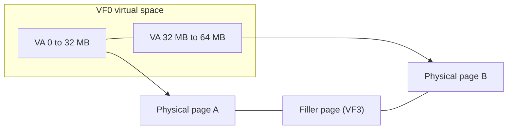

# EN2 Nest and NPU DMAC with MMU: DMAC-MMU-C-03 Page Crossing and Non-Zero VA

Parent issue: #TBD (EN2 Nest and NPU DMAC with MMU Test Plan). Group: P1 sub-issue #TBD.

> **ID convention:** `DMAC-MMU-C-nn` = **C**andidate test (to be written).

| | |
|---|---|
| Runs on | Nest |
| Executable | `test-nest-dmac-mmu-bm.elf` (existing) |
| Source | `tests/common/test-bm/TestDmacMmu.cpp`, as two new `TEST_F_CLEAN` cases in `DmacMmuFixture`: `NonZeroVaOffset` and `PageCrossing`. No CMake change. |
| Items closed | 2: behaviour 15 (transfer crosses a page boundary) and behaviour 16 (transfer starts at a non-zero VA) |
| Coverage | If P1 is done in order (after C-01 and C-02): 66.1% to **69.5%** (+3.4%). Final P1 figure is 74.6%. |

## Goal

Cover two cases in the translated path: a transfer that starts inside a page, and one that crosses from one VA page into the next where the two pages are **not** physical neighbours.

## Background

- Pages are 32 MB (`CONFIG_SYSTEM_MMU_PAGE_SIZE_MB`), and a page occupies its whole segment. Every existing translated test starts at VA 0 and stays inside one page.
- `MmuMemApi::allocate(bytes, client, va)` places an allocation at a given page-aligned VA when `va` is non-zero. A single multi-page allocation takes **contiguous** physical pages, so it cannot show a crossing fault. Use one-page allocations with a filler page between them.
- `physOf(va, client)` returns the physical address a client's own table gives that VA.
- DDR addresses and sizes must be a multiple of the region width, so choose offsets that are.

## Fixture additions

| Addition | Purpose |
|---|---|
| `stampClient(client, va, pattern)` | Fills a client page by a translated L3 to DDR single-block write through `xfer`. |
| `expectPage(client, va, offset, expected, len)` | Turns translation off, finds the page with `physOf`, checks `readableByCore`, and compares `len` bytes. |

These helpers are shared with C-01, C-02 and C-04. Whichever lands first adds them.

## NonZeroVaOffset

1. Call `selectEngine()` and `initMmu()`. Enable VF0 and VF3. Allocate a filler page for VF3 first, so VF0's page is not at physical page 0. Then allocate one VF0 page at VA 0.
2. Choose an offset that is a multiple of the DDR width, for example `0x12340`. Read the 32 bytes before and after the target window (translation off) and keep them.
3. Fill an L3 buffer with an incrementing pattern (byte `i` = `i ^ 0x5A`), so a shifted copy is visible.
4. Clear `IRPT_AXI` and `IRPT_LUT`. Translation on. Write L3 to DDR at `VA + offset`, size 256, id VF0.
5. Translation off. Assert:
    - The 256 bytes at `physOf(VA, VF0) + offset` match the pattern.
    - The 32 bytes before and after are unchanged.
    - The first 256 bytes of the page (offset 0) do not hold the pattern, so a dropped offset is caught.
6. Read back with translation on (DDR to L3 at `VA + offset`) and compare all 256 bytes.

## PageCrossing

1. Allocate VF0 page A at VA 0. Allocate a filler page for VF3, which takes the next physical page. Allocate VF0 page B at VA = page size with `allocate(bufSz_, VF0, pageSize)`. Assert `b.va == pageSize`.
2. Assert `physOf(pageSize, VF0) != physOf(0, VF0) + pageStride_`. If they are equal the pages are neighbours, and the test cannot tell a crossing fault from a contiguous layout. Fail with a log rather than pass.
3. Keep the first 128 bytes of the filler page (translation off) to compare later.
4. Fill an L3 buffer with the incrementing pattern. Translation on. Write to VA `pageSize - 128`, size 256, id VF0. Half lands at the end of page A and half at the start of page B.
5. Translation off. Assert:
    - Bytes 0 to 127 are at `pA + pageSize - 128`.
    - Bytes 128 to 255 are at `pB`.
    - The filler page's first 128 bytes are unchanged. A linear run through physical space would have written them.
    - `readableByCore` holds for every address read.
6. Read the same window back with translation on (DDR to L3) and compare all 256 bytes.

## Pass and failure

**Pass when** both cases pass. **A failure means:** the offset was dropped or added, or the second half followed the physical address instead of the page table.

## Notes

- **Allocator order.** `PageCrossing` relies on first-fit physical allocation, as `RvMappedPfTransfer` does. Step 2 checks it, but the layout could change if the page pool changes.
- **Bursts.** A 32 MB boundary is also a 4 KB boundary, so the DMAC's bursts split there. This test does not cover a crossing that is not page-aligned.
- **Page budget.** `PageCrossing` uses three pages of 32 MB. `NonZeroVaOffset` uses two.

## Tracking

- [ ] Fixture additions (`stampClient`, `expectPage`) in `DmacMmuFixture`, if not already added
- [ ] DMAC-MMU-C-03 `NonZeroVaOffset`
- [ ] DMAC-MMU-C-03 `PageCrossing`

## Definition of done

- Both test cases added, built for EN2 with `ENABLE_EXTRA_METAL`, and passing on target.
- Frees what it allocates, turns translation off and clears `IRPT_AXI` and `IRPT_LUT`.
- Existing `DmacMmu` tests still pass.
- Coverage table in the parent issue updated.
