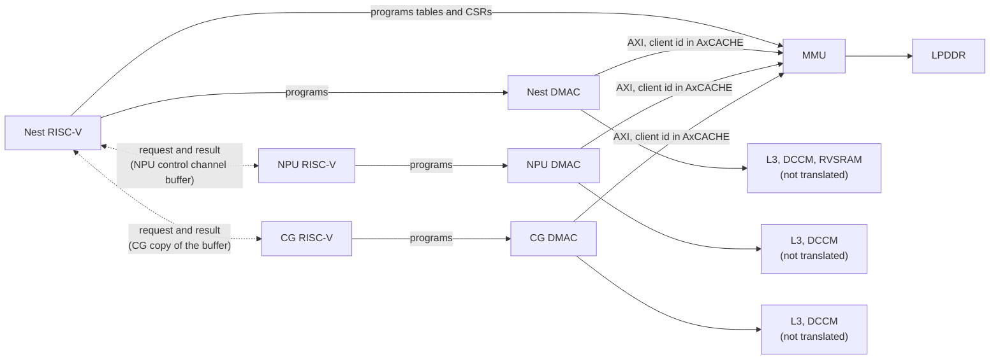
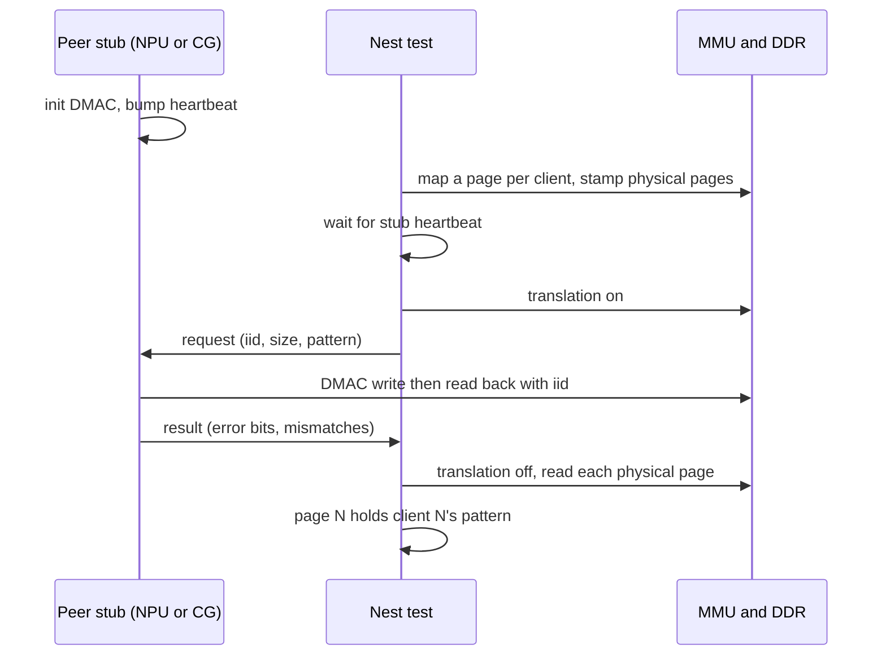
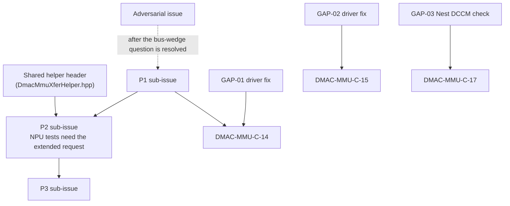

# EN2 Nest and NPU DMAC with MMU Test Plan

Test plan for the DMAC driver (`drivers/dmac`) on the Nest, the NPU and CG. The Nest programs the EN2 MMU for all three. CG has no MMU of its own, and the NPU and CG cannot program it. This issue holds the plan. Candidate tests are tracked in sub-issues (P1, P2, P3) and an adversarial issue. Three driver gaps are tracked as separate dependent issues, each with its own blocked test.

> **ID convention:** `DMAC-MMU-T-nn` = **T**est exists. `DMAC-MMU-C-nn` = **C**andidate driver test (not yet written). `DMAC-MMU-ADV-C-nn` = **C**andidate **adv**ersarial test (not yet written).

- [Objective](#objective)
- [Existing Tests](#existing-tests)
- [Recommended Test Additions](#recommended-test-additions)
- [Open questions](#open-questions)
- [Adversarial Tests](#adversarial-tests)

---

## Objective

### Purpose

Verify that the DMAC driver (`DmacEngine`, `DmacController`, `DmacSingleBlockDesc`, `DmacLinkedListDesc`) works with the MMU translating DDR traffic, on the Nest DMAC, and on the NPU and CG DMACs through tables the Nest programs. The DMAC names the MMU client for a transfer with `setIid`, and `applyIid` writes that id into `AR_CACHE` / `AW_CACHE` when the source or destination is LPDDR (`DmacDevice::isIidProgrammingRequired`). The tests check that the right client table is used, that the data lands in the right physical page, and that the driver behaves with translation on and off.

The MMU is a dependency here. MMU driver coverage is in the [EN2 MMU Test Plan](#TBD).

### Three processors, three roles

The Nest, the NPU and CG are different RISC-V processors with their own DMAC and different access to the bus. Each executable runs on one processor, so a test that involves two is a pair of executables.

| | Nest | NPU | CG |
|---|---|---|---|
| DMAC driven by | Nest RISC-V | NPU RISC-V | CG RISC-V |
| Memory the DMAC can address | LPDDR, L3, RVSRAM, DCCM | LPDDR, L3, DCCM | LPDDR, L3, DCCM |
| Linked-list descriptors | RVSRAM today (`DMAC_TEST_LL_POOL_ATTR`); DCCM should work too (a code comment says it fails; unverified) | DCCM (core cannot write DDR) | DCCM (core cannot write DDR) |
| MMU CSRs and tables | Programmed directly (`MmuDriver`, `MmuMemApi`), before any NPU transfer | Never programmed by the NPU; pre-programmed by the Nest | Never programmed by CG; pre-programmed by the Nest |
| Untranslated tests | Standalone ELFs (`TestDmacLife`, `TestDmacHwSpeed`, `TestDmacMmu`) | Standalone ELFs (`TestDmacLife`, `TestDmacHwSpeed`) | Standalone `TestDmacLife` in `test-cg-core-suite.elf` (single block) |
| Translated tests | Standalone ELF (`TestDmacMmu`) | **Paired** with the Nest: the Nest programs the MMU and checks the result | **Paired** with the Nest, like the NPU (proposed, C-16) |
| Reads physical DDR to verify | Yes, with translation off | Only through the Nest | Only through the Nest (proposed, C-16) |

The NPU can run standalone, untranslated DMAC tests against L3, DDR and DCCM with no Nest involvement. A translated NPU transfer is a **pair**.

CG is paired with the Nest the same way as the NPU. CG has no MMU of its own, and it cannot program the MMU, so the Nest pre-programs the tables. CG programs the client id on its DMAC, so each transfer uses the table for that id. The Nest sends the request through the peer's control channel buffer, then checks the result and the physical pages. Standalone CG runs (single-block Life cases in `test-cg-core-suite.elf`) stay untranslated.

There are three ways the same source is reused across the two processors:

| Pattern | How it works | Examples |
|---|---|---|
| Same test source, recompiled for each processor | One `.cpp`, one ELF per processor, selected by `SYSTEM_TYPE_NEST` / `SYSTEM_TYPE_NPU` and `DmacTestInterface.hpp` | `TestDmacLife.cpp`, `TestDmacHwSpeed.cpp`, new `TestDmacDescriptor.cpp` (C-10) |
| Nest test plus peer stub (NPU or CG) | Nest ELF owns the MMU; the stub only runs the transfer it is handed | `TestNestDmacMmuNpu.cpp` + `TestNpuDmacMmuStubMain.cpp` (NPU and CG builds) |
| Shared helper header | The transfer, wait and reset code written once and included by both sides | Proposed `DmacMmuXferHelper.hpp` (see [Test hygiene](#test-hygiene)) |

### Layers

### Paired test flow

### Driver gaps

| Gap | Summary | Issue | Blocked test |
|---|---|---|---|
| GAP-01 |  A linked-list write to DDR does not work on the Nest, with or without the MMU. `LinkedListUidSweep` is disabled because of it. The NPU and CG cores cannot write DDR, so their descriptors go in DCCM instead (see Test hygiene). | #TBD | DMAC-MMU-C-14 |
| GAP-02 | `DmacController::handleDmacControllerError` is "Not implemented" and returns false. | #TBD | DMAC-MMU-C-15 |
| GAP-03 | Nest linked-list descriptors are pinned to RVSRAM by `DMAC_TEST_LL_POOL_ATTR`, because a code comment says the LLP fetch fails from DCCM and L3. The comment is unverified, and DCCM is expected to work. | #4247 | DMAC-MMU-C-17 |

### Build and run

- Nest executables are registered in `tests/device/en2/nest/CMakeLists.txt`, NPU executables in `tests/device/en2/npu/CMakeLists.txt`, and CG executables in `tests/device/en2/cg/CMakeLists.txt`, next to the existing DMAC lines.
- **CG build:** `TestDmacLife` runs in `test-cg-core-suite.elf`. The standalone CG DMAC ELFs (`test-cg-dmac-life-bm.elf`, `test-cg-dmac-hw-speed-bm.elf`) are commented out in its CMake file.
- The NPU stub `test-npu-dmac-mmu-stub.elf` is built with `add_executable` in the NPU CMake file and linked with `npu_l3_test.lds`.
- Proposed CG pair (C-16): `test-cg-dmac-mmu-stub.elf` in the CG CMake file, and `test-nest-dmac-mmu-cg-bm.elf` on the Nest. Neither exists yet.
- **Run order for a pair:** start the peer stub (NPU or CG) first, then the Nest ELF. The stub waits for a request, and the Nest gives up if the stub heartbeat never moves.
- **One pair at a time.** The NPU and CG control channel buffers are shared with the other Nest tests.
- Tests use `TEST_F_CLEAN`. Confirm these run in the EN2 Nest and NPU ELFs, as they do for the MMU ELFs.

---

## Existing Tests

Four test sources exist. `TestDmacLife` and `TestDmacHwSpeed` do not configure the MMU, so their DDR transfers run with translation not configured. `TestDmacMmu` and `TestNestDmacMmuNpu` are the translated tests. On CG, `TestDmacHwSpeed` and the linked-list Life cases are disabled at build time.

| Source | Nest executable | NPU executable | CG executable | Runs on |
|---|---|---|---|---|
| `TestDmacLife.cpp` | `test-nest-dmac-life-bm.elf` | `test-npu-dmac-life-bm.elf` | `test-cg-core-suite.elf` (single block only) | Nest, NPU, CG |
| `TestDmacHwSpeed.cpp` | `test-nest-dmac-hw-speed-bm.elf` | `test-npu-dmac-hw-speed-bm.elf` | none (`NormalTest` disabled on CG) | Nest, NPU |
| `TestDmacMmu.cpp` | `test-nest-dmac-mmu-bm.elf` | n/a | n/a | Nest |
| `TestNestDmacMmuNpu.cpp` | `test-nest-dmac-mmu-npu-bm.elf` | `test-npu-dmac-mmu-stub.elf` (stub) | proposed `test-cg-dmac-mmu-stub.elf` (C-16) | Paired (Nest and NPU; CG proposed) |

| ID | Test | Runs on | What it checks |
|---|---|---|---|
| DMAC-MMU-T-01 | `Dmac` single-block matrix (`TestDmacLife.cpp`) | Nest, NPU, CG | One test per memory pair, single-block path. L3, DCCM and DDR pairs on all three processors (7 pairs); RVSRAM pairs on the Nest only (6 more). Source and destination are compared against a control copy. 13 cases on the Nest, 7 on the NPU, 7 on CG. |
| DMAC-MMU-T-02 | `Dmac` linked-list matrix (`TestDmacLife.cpp`) | Nest, NPU (CG disabled) | Same pairs through a one-entry linked list. The Nest keeps the descriptor in RVSRAM. 13 cases on the Nest, 7 on the NPU, none on CG (disabled at build time). |
| DMAC-MMU-T-03 | `DmacHwSpeed.NormalTest` (`TestDmacHwSpeed.cpp`) | Nest, NPU (CG disabled) | Throughput sweep: every DMAC engine, several block sizes, source and destination memory pairs, multi-entry linked lists, completion by `checkXferComplete`. Reports cycles. |
| DMAC-MMU-T-04 | `DmacMmu.IidRangeCheck` | Nest | `setIid` accepts `maxIid_` and rejects `maxIid_ + 1` on single-block and linked-list descriptors; a rejected id leaves the descriptor unchanged; `init` clears the id. |
| DMAC-MMU-T-05 | `DmacMmu.UidSweep` | Nest | Maps the same VA in the PF and VF0 to VF7 tables. Each client writes its own pattern through its id, then reads it back; translation is turned off and each physical page is checked. |
| DMAC-MMU-T-06 | `DmacMmu.RvMappedPfTransfer` | Nest | Maps a PF buffer into the RISC-V table with `memMapRv`. DMAC writes and reads through the RISC-V VA; the data must land in the PF physical page. |
| DMAC-MMU-T-07 | `DmacMmu.LinkedListUidSweep` (**disabled**) | Nest | Same as T-05 through a linked list. Disabled because a linked list write to DDR from another memory fails even without the MMU. See GAP-01. |
| DMAC-MMU-T-08 | `NestDmacMmuNpu.NpuTranslatedTransfer256` | Paired | The Nest maps one page per client at VA 0. The NPU DMAC writes and reads back 256 bytes once per client id; the Nest checks each physical page. |
| DMAC-MMU-T-09 | `NestDmacMmuNpu.NpuTranslatedTransfer4k` | Paired | Same, 4 KB. |
| DMAC-MMU-T-10 | `NestDmacMmuNpu.NpuTranslatedTransfer64k` | Paired | Same, 64 KB. |

### Coverage analysis (current tests)

**Metric.** Coverage = items exercised by at least one existing test ÷ total items. Items are the **30 MMU-relevant driver functions** (descriptor, engine, controller and device functions, overloads counted separately) plus **29 behaviours** (translated paths, id rules, sizes, engines, descriptor limits, error handling, the gaps above, CG-issued translated transfers, and Nest linked lists from DCCM). Behaviours are counted once per row, even where they apply to more than one processor. CG adds one behaviour (28): translated transfers that CG issues with its own client id, which no current test covers. Adversarial tests are not counted.

| Item type | Total | Covered now | Coverage |
|---|---|---|---|
| Driver functions | 30 | 23 | 76.7% |
| Behaviours | 29 | 11 | 37.9% |
| **Total** | **59** | **34** | **57.6%** |

Driver functions not covered by any test: `DmacSingleBlockDesc::init` (64-bit overload), `DmacLinkedListDesc::getCnt`, `getPoolCnt`, `getLLHead`, `logDesc`, `DmacController::enableDmac` (only reached through `init`), and `handleDmacControllerError` (not implemented).

---

## Recommended Test Additions

### Sub-issues and coverage progression

| Issue | Candidate tests | Items closed | Gain | Coverage after |
|---|---|---|---|---|
| Today | n/a | n/a | n/a | 57.6% |
| **P1 sub-issue** (Nest translated paths) | DMAC-MMU-C-01 to C-05 | 10 | +16.9% | **74.6%** |
| **P2 sub-issue** (NPU, CG and robustness) | DMAC-MMU-C-06 to C-11, C-16 | 10 | +16.9% | **91.5%** |
| **P3 sub-issue** | DMAC-MMU-C-12 to C-13 | 2 | +3.4% | **94.9%** |
| GAP-01 (#TBD) | DMAC-MMU-C-14 | 1 | +1.7% | 96.6% |
| GAP-02 (#TBD) | DMAC-MMU-C-15 | 1 | +1.7% | 98.3% |
| GAP-03 (#4247) | DMAC-MMU-C-17 | 1 | +1.7% | **100%** |
| **Adversarial** | DMAC-MMU-ADV-C-01 to C-05 | not counted | n/a | n/a (see [Adversarial Tests](#adversarial-tests)) |

### Candidate tests

P1, P2 and P3 tests can be written against the current driver. GAP tests are **blocked until the driver supports the capability**.

#### P1

**Translated Nest DMAC paths and driver functions no test covers.** Coverage after this group: 74.6%.

| ID | Candidate test | Runs on | Executable | Items |
|---|---|---|---|---|
| DMAC-MMU-C-01 | Multi-entry linked list, translated, one id for the whole list | Nest | `test-nest-dmac-mmu-bm.elf` | 4 |
| DMAC-MMU-C-02 | DDR to DDR translated | Nest | `test-nest-dmac-mmu-bm.elf` | 1 |
| DMAC-MMU-C-03 | Page crossing and non-zero VA | Nest | `test-nest-dmac-mmu-bm.elf` | 2 |
| DMAC-MMU-C-04 | Id rules: none named, ignored for non-DDR | Nest | `test-nest-dmac-mmu-bm.elf` | 2 |
| DMAC-MMU-C-05 | Non-DDR traffic with translation on | Nest | **New:** `test-nest-dmac-life-mmu-bm.elf` (`TestDmacLife.cpp`, recompiled) | 1 |

#### P2

**NPU and CG translated transfers, and robustness tests.** Coverage after this group: 91.5%.

| ID | Candidate test | Runs on | Executable | Items |
|---|---|---|---|---|
| DMAC-MMU-C-06 | NPU linked list translated | Paired | `test-nest-dmac-mmu-npu-bm.elf` + `test-npu-dmac-mmu-stub.elf` | 1 |
| DMAC-MMU-C-07 | NPU DDR to DDR translated | Paired | same pair | 1 |
| DMAC-MMU-C-08 | Every controller and engine, engines in parallel | Nest and Paired | `test-nest-dmac-mmu-bm.elf`; same NPU pair | 2 |
| DMAC-MMU-C-09 | Remap between transfers | Nest and Paired | `test-nest-dmac-mmu-bm.elf`; same NPU pair | 1 |
| DMAC-MMU-C-10 | Descriptor limits | Both, same source | **New:** `test-nest-dmac-desc-bm.elf` and `test-npu-dmac-desc-bm.elf` (`TestDmacDescriptor.cpp`) | 3 |
| DMAC-MMU-C-11 | Controller reset and re-enable | Nest | `test-nest-dmac-mmu-bm.elf` | 1 |
| DMAC-MMU-C-16 | CG translated write and read per client id | Paired | `test-nest-dmac-mmu-cg-bm.elf` (new, `TestNestDmacMmuNpu.cpp` with a CG define) + `test-cg-dmac-mmu-stub.elf` (new, `TestNpuDmacMmuStubMain.cpp` in the CG build) | 1 |

#### P3

**Throughput and long-run tests.** Coverage after this group: 96.6%.

| ID | Candidate test | Runs on | Executable | Items |
|---|---|---|---|---|
| DMAC-MMU-C-12 | Throughput, translation on vs off | Nest | **New:** `test-nest-dmac-hw-speed-mmu-bm.elf` (`TestDmacHwSpeed.cpp`, recompiled) | 1 |
| DMAC-MMU-C-13 | Soak | Nest and Paired | **New:** `test-nest-dmac-mmu-soak-bm.elf` (`TestDmacMmuSoak.cpp`) | 1 |

#### GAP-01 (blocked)

**Blocked until the driver supports a translated linked-list write to DDR.** Coverage after this test: 98.3%.

| ID | Candidate test | Runs on | Executable | Items |
|---|---|---|---|---|
| DMAC-MMU-C-14 | Linked list translated write to DDR | Nest | `test-nest-dmac-mmu-bm.elf` | 1 |

#### GAP-02 (blocked)

**Blocked until the driver supports controller error relay.** Coverage after this test: 100%.

| ID | Candidate test | Runs on | Executable | Items |
|---|---|---|---|---|
| DMAC-MMU-C-15 | Controller error relay | Nest | `test-nest-dmac-mmu-bm.elf` | 1 |

#### GAP-03 (blocked)

**Blocked until a Nest linked list fetched from DCCM is confirmed on hardware.** Coverage after this test: 100%.

| ID | Candidate test | Runs on | Executable | Items |
|---|---|---|---|---|
| DMAC-MMU-C-17 | Nest linked list fetched from DCCM (untranslated, then translated) | Nest | `test-nest-dmac-mmu-bm.elf` (new `TEST_F_CLEAN` case with the pool in `.dccm_noinit`) | 1 |

Details, notes and definition of done are in each sub-issue and gap issue.

### Behaviours and where they are covered

| # | Behaviour | Runs on | Covered by |
|---|---|---|---|
| 1 | Single-block translated write per client id (PF, VF0 to VF7) | Nest | T-05 |
| 2 | Single-block translated read per client id | Nest | T-05 |
| 3 | Data lands in the id's own physical page | Nest | T-05 |
| 4 | DMAC reaches a PF buffer through its RISC-V alias | Nest | T-06 |
| 5 | Id above `maxIid_` rejected, descriptor unchanged | Nest | T-04 |
| 6 | `init` clears the id on reuse (single block and linked list) | Nest | T-04 |
| 7 | NPU translated write and read per client id | NPU | T-08 to T-10 |
| 8 | NPU translated transfers at 256 B, 4 KB, 64 KB | NPU | T-08 to T-10 |
| 9 | DDR transfers, translation not configured (single block, multi-entry linked list) | Nest, NPU, CG (CG single block only) | T-01 to T-03 |
| 10 | Non-DDR transfers (L3, DCCM, RVSRAM), translation not configured | Nest, NPU, CG (RVSRAM on the Nest only) | T-01, T-02 |
| 11 | Several engines in parallel | Nest, NPU | T-03 |
| 12 | Linked list translated write to DDR | Nest | C-14 (GAP-01) |
| 13 | Multi-entry linked list, translated, one id for the whole list | Nest | C-01 |
| 14 | DDR to DDR translated (id on read and write) | Nest | C-02 |
| 15 | Transfer crosses a page boundary | Nest | C-03 |
| 16 | Transfer starts at a non-zero VA | Nest | C-03 |
| 17 | Both engines of a controller, different ids, at once | Nest | C-08 |
| 18 | Every controller and engine, not only controller 0 engine 0 | Both | C-08 |
| 19 | Translation on, no id named | Nest | C-04 |
| 20 | Id ignored for non-DDR regions | Nest | C-04 |
| 21 | Non-DDR traffic unaffected by translation on | Nest | C-05 |
| 22 | Remap between transfers; DMAC sees the new mapping | Both | C-09 |
| 23 | Descriptor limits (minimum size, alignment, maximum, invalid region, full pool) | Both | C-10 |
| 24 | NPU linked list translated | NPU | C-06 |
| 25 | NPU DDR to DDR translated | NPU | C-07 |
| 26 | Throughput with translation on vs off | Nest | C-12 |
| 27 | Randomized long-run mix | Both | C-13 |
| 28 | CG translated write and read per client id (CG programs the id; Nest tables select the page) | CG (paired) | C-16 |
| 29 | Nest linked list fetched from DCCM | Nest | C-17 (GAP-03) |

### Dependency order

### Test hygiene

- **Share the transfer code.** `TestDmacMmu.cpp` and `TestNpuDmacMmuStubMain.cpp` each carry their own `xfer`, wait loop, `resetEngine` and ISRs. Move them into one header, `tests/common/test-bm/DmacMmuXferHelper.hpp`, included by both sides and by the new tests.
- **Extend the NPU request once.** C-06 to C-09 need new fields in `NpuDmacMmuRequest` (`mode`, source address, `controller`, `engine`). Add them in one change to `NpuDmacMmuTestInterface.hpp`. C-16 also needs the CG copy of the control channel buffer (see Open questions).
- **Leave MMU state clean.** Each test frees what it allocates, turns translation off, and clears `IRPT_AXI` and `IRPT_LUT`.
- **Reset after errors.** Dispatching onto a channel in error wedges rather than fails, so use `disableDmac` and `init` as `resetEngine` does.
- **Keep DMA buffers uncached** (`.l3_noinit_uncached`, `.rvsram_noinit_uncached`). NPU buffers can go in DCCM or L3.
- **Place linked-list descriptors by processor.** The NPU and CG cores cannot write DDR, so their descriptors go in DCCM. The DMAC can reach NPU and CG DCCM, so these linked lists can be tested. Nest descriptors are in RVSRAM today (`DMAC_TEST_LL_POOL_ATTR`), but DCCM should work for the Nest too. Test the Nest DCCM path (GAP-03, C-17), and drop the RVSRAM pin if it passes.
- **Beware the DRAM window.** The Nest core cannot read DDR past the DRAM window; a read there hangs the bus. Use `readableByCore` before verification reads.
- **Stale comments to verify.** `TestDmacLife.cpp` says "The NPU cannot directly access DDR", and `TestNpuDmacMmuStubMain.cpp` says "The NPU DMAC reaches no L3". The NPU BSP maps LPDDR, L3 and DCCM, so these comments are either out of date or describe an L3 failure seen on hardware. Check which before relying on either.

---

## Open questions

- **CG client ids.** Confirm that the id CG programs maps to the same MMU client table as the NPU (PF=0, VF0 to VF7=1 to 8). C-16 depends on it.
- **CG control channel view.** The dual NPU+CG layout has a CG copy of `CcCsr` (index 1 in `memory-maps/device/en2/En2MemoryMapDefinitions.yaml`). Confirm the view tag for it, because the Nest side currently uses the NPU tag.
- **Why CG linked-list cases are disabled.** `TestDmacLife` disables them when built for CG. The code does not say why. Check whether it is the same linked-list DDR write fault as GAP-01.
- **CG stub source.** Confirm whether the CG stub can be built from `TestNpuDmacMmuStubMain.cpp` with the CG system type, or needs its own source.
- **Linked-list fetch from DCCM on the NPU and CG.** A code comment in `DmacTestInterface.hpp` says the Nest's LLP fetch fails from DCCM and L3. No test result or log in the repo backs it up. The plan puts NPU and CG descriptors in DCCM, so confirm the fetch works there. The same should hold on the Nest, so add a Nest DCCM linked-list test and drop the RVSRAM pin if it passes. Also check which section the NPU `TestDmacLife` linked-list pool uses today, since T-02 passes on the NPU.

---

## Adversarial Tests

Tracked in a separate issue: [EN2 Nest and NPU DMAC with MMU: Adversarial Tests](#TBD). These tests make the DMAC issue an illegal translated access on purpose and check that the DMAC and the MMU report it and recover. They check hardware fault reporting seen through the DMAC channel error bits, so they are **not counted** in the 57-item metric.

| ID | Test | Runs on | Fault injected | Expected |
|---|---|---|---|---|
| DMAC-MMU-ADV-C-01 | `UnmappedVa` | Nest | DMAC access to a VA whose PTE has `valid = 0` | DMAC channel decode or slave error bits; MMU `buserr`; Nest responsive |
| DMAC-MMU-ADV-C-02 | `ReadOnlyPageWrite` | Nest | DMAC write through a PTE committed with `write_en = 0` | DMAC channel error bits; MMU `buserr` |
| DMAC-MMU-ADV-C-03 | `DisabledClientIid` | Paired | NPU DMAC transfer with the id of a client whose `client_en` is off | NPU stub reports error bits; MMU `buserr` |
| DMAC-MMU-ADV-C-04 | `UnprovisionedIid` | Paired | Id above the highest MMU client but within `maxIid_` | Error, not data; `setIid` accepts it today |
| DMAC-MMU-ADV-C-05 | `StaleTranslation` | Nest | Free the page, then DMAC to the old VA | Error, not stale data |

These relate to the MMU tests `MMU-ADV-C-01` to `C-03` and share their hazard: existing tests state that an access to an unmapped segment "returns no error and wedges the bus". Resolve that before writing ADV-C-01.
