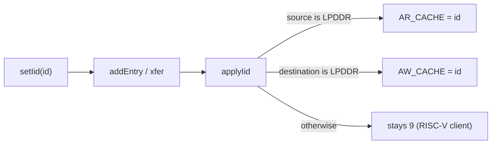
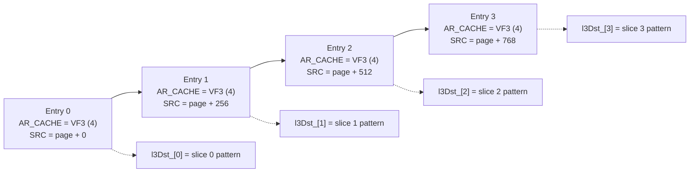
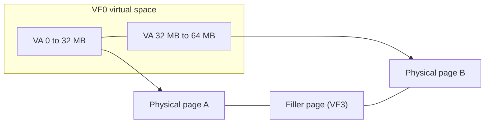

# EN2 Nest and NPU DMAC with MMU: P1 Test Details (C-01 to C-05)

Parent issue: #TBD (EN2 Nest and NPU DMAC with MMU Test Plan). Sub-issue: #TBD (P1 Candidate Tests).

This page says what each P1 test should do. The P1 sub-issue table stays the summary. All five tests run on the **Nest**, which owns the MMU.

> **ID convention:** `DMAC-MMU-C-nn` = **C**andidate test (to be written).

| ID | Test | Items | Executable | Source |
|---|---|---|---|---|
| DMAC-MMU-C-01 | Multi-entry linked list, translated, one id for the whole list | 4 | `test-nest-dmac-mmu-bm.elf` | `TestDmacMmu.cpp` |
| DMAC-MMU-C-02 | DDR to DDR translated | 1 | `test-nest-dmac-mmu-bm.elf` | `TestDmacMmu.cpp` |
| DMAC-MMU-C-03 | Page crossing and non-zero VA | 2 | `test-nest-dmac-mmu-bm.elf` | `TestDmacMmu.cpp` |
| DMAC-MMU-C-04 | Id rules: none named, ignored for non-DDR | 2 | `test-nest-dmac-mmu-bm.elf` | `TestDmacMmu.cpp` |
| DMAC-MMU-C-05 | Non-DDR traffic with translation on | 1 | **New:** `test-nest-dmac-life-mmu-bm.elf` | `TestDmacLife.cpp` (recompiled) |

## How the id reaches the hardware

These facts from the driver shape every test below.

- `setIid` stores an id in the descriptor. `applyIid` writes it into `AR_CACHE` when the **source** is LPDDR and into `AW_CACHE` when the **destination** is LPDDR. The other direction keeps the default.
- The default is 9 in both fields (`DmacEngine::processCtl`). Client 9 is the RISC-V client, which `MmuMemApi::enable()` leaves untranslated.
- A linked-list entry takes the id the descriptor holds when `addEntry` runs, so call `setIid` **before** `addEntry`.
- `init` clears the id on both descriptor types.
- When a linked-list transfer completes, `handleDescriptorDone` resets the descriptor: `getCnt()` and `getPoolCnt()` return 0, and `getLLHead()` returns null. Check the list **before** dispatch, and check the reset **after**.

## Shared setup

Add these to `DmacMmuFixture` in `TestDmacMmu.cpp`. C-05 does not use them.

| Addition | Purpose |
|---|---|
| `llMultiBuffer_[4]` and `llMultiPool_[4]` | A four-entry pool for C-01. Place it with `DMAC_TEST_LL_POOL_ATTR` like `llDescBuffer_`. Fill the pointer array in `setUp`. The existing one-entry pool and `xferLl` stay as they are. |
| `l3Dst_[4]` (256 B each) | Destination buffers for C-01. Put them in `.l3_noinit_uncached`, as `TestDmacLife.cpp` does, so the core sees DMA writes. |
| `dccmBuf_` (256 B) | A DCCM buffer for C-04, in `.dccm_noinit`, as in `TestDmacLife.cpp`. |
| `ctlOf(const DmacLLHWDesc *)` | Returns `eai::nriscv::DmacChannel::CH_CTLStruct` built from `CHx_CTL_hi` and `CHx_CTL_lo`, so a test can read `__AR_CACHE` and `__AW_CACHE`. |
| `stampClient(client, va, pattern)` | Fills a client page with a pattern by a translated L3 to DDR single-block write through `xfer`, as phase one of `UidSweep` does. |
| `expectPage(client, va, offset, expected, len)` | Turns translation off, finds the page with `physOf`, checks `readableByCore`, and compares `len` bytes. It wraps the read-back loop in `UidSweep`. |

**Clients.** Use PF (id 0), VF0 (1), VF3 (4) and VF7 (8): both ends and the middle.

**Patterns.** Use `0xD0 + client`. `UidSweep` uses `0xC0 +` and the disabled linked-list sweep uses `0xB0 +`, so a page left behind by another test cannot look like a pass.

**Every test:** call `selectEngine()` and `initMmu()` first. Clear `IRPT_AXI` and `IRPT_LUT` before each transfer, and assert both are 0 after it. Free every allocation on every exit path (`freeClients`). Turn translation off before any core read of DDR.

---

## DMAC-MMU-C-01: Multi-entry linked list, translated, one id for the whole list

**Goal.** One linked list with four entries, all from one client (VF3). The list carries one client id, set once before the first `addEntry`. Each entry reads a different 256 B slice of that client's page, so the entries exercise the address progression through the translation. Each entry must return its own slice. This is the first test with more than one entry, and the first to inspect the list.

**Closes (4 items):** `DmacLinkedListDesc::getCnt`, `getPoolCnt`, `getLLHead`, and behaviour 13.

**Steps**

1. Enable VF3 (id 4). Allocate one 1 KB allocation for VF3 with `allocate(1024, VF3)`, which takes one page. Note its VA `page`.
2. Split the page into four 256 B slices. Stamp slice k with `0xD0 + k`, translation on, using `stampClient` on each slice's VA (`page + 256 * k`).
3. `linkedListDesc_.init(llMultiPool_, 4)`.
4. Call `setIid(4)` once, before the first `addEntry`. Then, for k = 0 to 3: `addEntry(DDR lo of page + 256 * k, LPDDR hi, l3Dst_[k] lo, L3 hi, 256)`. The destination is L3, so the translated write to DDR (GAP-01) is not needed.
5. **Before dispatch**, assert:
    - `getCnt() == 4`, `getPoolCnt() == 4`, and `getLLHead() == &llMultiBuffer_[0]`.
    - Entry k's `CHx_LLP` equals the AXI address of entry k+1 (`ptrToAxiAddrDmac`), and the last entry's LLP is 0.
    - `DmacEngine::checkLastLLElem` is true for entry 3 only.
    - For each entry, `ctlOf(entry).__AR_CACHE` equals 4 (VF3, the list's one id), and `__AW_CACHE == 9` (the destination is L3, so it is not programmed).
6. Fill every `l3Dst_[k]` with `0xFF`. Dispatch with `pEngine_->xfer(&linkedListDesc_)` and wait for `dmacDone_`. `getChannelError()` must be `NONE`.
7. **After completion**, assert:
    - Every `l3Dst_[k]` holds 256 bytes of `0xD0 + k`.
    - `IRPT_AXI` and `IRPT_LUT` are 0.
    - `getCnt() == 0`, `getPoolCnt() == 0`, and `getLLHead() == nullptr`.
    - Each entry's `CHx_LLP_STATUS_lo` and `_hi` no longer equal the seed `0xF0F0F0F0` that `addEntry` wrote, which shows the entry ran. Confirm on hardware that the DMAC writes this back for entries that finish cleanly.
8. Do not call `setIid` between entries. The id is set once for the list, and a multi-id list is not a supported use of the API.

**Pass when** every assertion holds. **A failure means:** an entry read the wrong slice (its address was built wrong or the offset was dropped), an entry's id is not the list's id, or the chain or count is wrong.

---

## DMAC-MMU-C-02: DDR to DDR translated

**Goal.** A single-block transfer with LPDDR at both ends. One id goes into **both** `AR_CACHE` and `AW_CACHE`, so both the read and the write must use that client's table.

**Closes (1 item):** behaviour 14.

**Steps** (repeat for PF and VF7)

1. Allocate two pages for client X: source at VA 0, destination at the next VA (`allocate` twice, and assert the two VAs differ).
2. Stamp the source page with `0xD0 + X`. Stamp the destination page with `0xFF`, so an untouched destination is visible.
3. `xfer(src DDR lo, LPDDR hi, dst DDR lo, LPDDR hi, 256, X)`.
4. Turn translation off. Using `physOf` for each VA:
    - The destination page holds `0xD0 + X`.
    - The source page still holds `0xD0 + X`.
    - `IRPT_AXI` and `IRPT_LUT` are 0.

**Pass when** the destination page changed and the source did not. **A failure means:** if the id reached only the read side, the write would use id 9 (RISC-V, untranslated) and land at the physical address equal to the destination VA, leaving the destination page at `0xFF`.

**Caution.** A failing run writes 256 bytes at the physical address equal to the destination VA. Check that range is not used by the image before running on hardware.

---

## DMAC-MMU-C-03: Page crossing and non-zero VA

**Goal.** Two cases in the translated path: a transfer that starts inside a page, and one that crosses from one VA page into the next, where the two pages are **not** physical neighbours.

**Closes (2 items):** behaviours 15 and 16. Write them as two `TEST_F_CLEAN` cases, `NonZeroVaOffset` and `PageCrossing`.

### NonZeroVaOffset

1. Allocate a filler page for VF3 first, so VF0's page is not at physical page 0. Then allocate one VF0 page at VA 0.
2. Read the 32 bytes before and after the target window (translation off) and keep them. Use an offset that is a multiple of the DDR width, for example `0x12340`.
3. Fill an L3 buffer with an incrementing pattern (byte `i` = `i ^ 0x5A`), so a shifted copy is visible.
4. Translation on. Write L3 to DDR at `VA + offset`, size 256, id VF0.
5. Translation off. Assert:
    - The 256 bytes at `physOf(VA, VF0) + offset` match the pattern.
    - The 32 bytes before and after are unchanged.
    - The first 256 bytes of the page (offset 0) do not hold the pattern, so a dropped offset is caught.
6. Read back with translation on (DDR to L3 at `VA + offset`) and compare.

### PageCrossing

1. Allocate VF0 page A at VA 0. Allocate a filler page for VF3, which takes the next physical page. Allocate VF0 page B at VA = page size with `allocate(bufSz_, VF0, pageSize)`. Assert `b.va == pageSize`.
2. Assert `physOf(pageSize, VF0) != physOf(0, VF0) + pageStride_`. If they are equal the pages are neighbours and the test cannot tell a crossing fault from a contiguous layout. Fail with a log rather than pass. This relies on first-fit physical allocation, as `RvMappedPfTransfer` does.
3. Keep the first 128 bytes of the filler page (translation off) to compare later.
4. Incrementing 256-byte pattern in L3. Translation on. Write to VA `pageSize - 128`, size 256, id VF0. Half lands at the end of page A and half at the start of page B.
5. Translation off. Assert:
    - Bytes 0 to 127 are at `pA + pageSize - 128`.
    - Bytes 128 to 255 are at `pB`.
    - The filler page's first 128 bytes are unchanged. A linear run through physical space would have written them.
    - `readableByCore` holds for every address read.
6. Read the same window back with translation on (DDR to L3) and compare all 256 bytes.

**Pass when** both cases pass. **A failure means:** the offset was dropped or added, or the second half followed the physical address instead of the page table.

---

## DMAC-MMU-C-04: Id rules

**Goal.** Pin down the two id rules: what happens when no id is named, and that the id is ignored when neither end is LPDDR.

**Closes (2 items):** behaviours 19 and 20. Write them as two `TEST_F_CLEAN` cases, `NoIdNamed` and `IdIgnoredForNonDdr`.

### NoIdNamed

Part one needs no hardware.

1. Build a linked-list entry for DDR to L3 with **no** `setIid`. Assert `__AR_CACHE == 9` and `__AW_CACHE == 9`.
2. Call `setIid(5)`, then `init` again and build another entry. Assert both fields are 9 again. This ties to T-04, which checks that `init` clears the id.

Part two is an observation first, then an assertion.

3. Translation on. Allocate a filler page for VF3, then one VF0 page at VA 0, and stamp it with `0xD0`. Before the transfer, read the first 256 bytes at physical offset 0 with the core (translation off) and keep them.
4. Translation on. Read DDR to L3 at VA 0 with **no** `setIid`.
5. Compare the result with two candidates: the VF0 pattern (the id picked VF0's table) and the bytes read from physical offset 0 (the id was 9, untranslated, so the address went through as physical).
6. Expected from the code: id 9, RISC-V client untranslated, so the result matches physical offset 0 and not the VF0 pattern. Pick a pattern that differs from physical offset 0. Log which candidate matched. If the hardware shows something else, record it and change the assertion and the plan.

### IdIgnoredForNonDdr

Descriptor level, using linked-list entries with `setIid(5)`:

| Source | Destination | Expected `AR_CACHE` | Expected `AW_CACHE` |
|---|---|---|---|
| L3 | DCCM | 9 | 9 |
| DCCM | L3 | 9 | 9 |
| DDR | L3 | 5 | 9 |
| L3 | DDR | 9 | 5 |
| DDR | DDR | 5 | 5 |

Hardware, with translation on:

1. Disable one client (`MmuMemApi::disableClient`), then call `setIid` with that client's id. If the id reached the MMU, the transfer would fault.
2. Run L3 to DCCM through the single-block path, then through the linked-list path.
3. Assert both transfers complete, the data matches the source, and `IRPT_AXI` and `IRPT_LUT` are 0.
4. Re-enable the client.

**Pass when** the table matches and the transfers are clean.

---

## DMAC-MMU-C-05: Non-DDR traffic with translation on

**Goal.** The existing `TestDmacLife` pairs that do not touch LPDDR must pass exactly as before when the MMU is enabled. This shows enabling translation does not disturb L3, DCCM or RVSRAM traffic, including the Nest's own access to its LPDDR image.

**Closes (1 item):** behaviour 21.

**Where.** New ELF `test-nest-dmac-life-mmu-bm.elf`, built from `TestDmacLife.cpp` with a compile definition (for example `DMAC_LIFE_MMU_ENABLED`). The CMake line is in the P1 sub-issue.

**Changes in `TestDmacLife.cpp`, only under the definition**

1. Include `MmuDriver.hpp`, `MmuMemApi.hpp` and `eai_nest_mmu_csr_nriscv.hpp`.
2. `setUp`, after `enableNestDmacPrerequisites()`: assert `MmuDriver::init(0)`, call `MmuMemApi::enable()`, and clear `IRPT_AXI` and `IRPT_LUT`. Enable no client.
3. `tearDown`: `MmuMemApi::disable()`.
4. At the end of each case, assert `IRPT_AXI == 0` and `IRPT_LUT == 0`.
5. Register only the pairs with no LPDDR end. Leave the DDR pairs out of this ELF, or register them as disabled.

| Run (9 pairs, single block and linked list, 18 cases) | Skipped (4 pairs, 8 cases) |
|---|---|
| `L3_L3`, `DCCM_DCCM`, `DCCM_L3`, `L3_DCCM`, `RVSRAM_RVSRAM`, `RVSRAM_DCCM`, `DCCM_RVSRAM`, `RVSRAM_L3`, `L3_RVSRAM` | `DDR_L3`, `DDR_DCCM`, `DDR_DDR`, `DDR_RVSRAM` |

The skipped pairs name no id, so they would run untranslated and prove nothing here. C-02 and C-04 cover DDR with translation on.

**Pass when** every case passes by the existing control-copy comparison, and no MMU status bit is set. **A failure means:** enabling the MMU disturbed non-DDR traffic. A hang means an MMU setting broke the core's own access to its LPDDR image, which the untranslated RISC-V client should prevent.

---

## Open points

- **Uncached L3.** `TestDmacMmu.cpp` uses `.l3_noinit` today. The new buffers use `.l3_noinit_uncached`. Check whether the existing buffers are exposed to stale cache reads.
- **Entry write-back.** C-01 step 7 assumes the DMAC writes per-entry status back. Confirm on hardware, or drop that check.
- **Allocator order.** C-03 assumes first-fit physical allocation. Step 2 checks it, but the layout could differ if the page pool is changed.
- **Physical offset 0.** C-04 reads LPDDR offset 0 with the core. That is inside the DRAM window, so the read is safe.

## Tracking

- [ ] DMAC-MMU-C-01 Multi-entry linked list, translated, one id for the whole list
- [ ] DMAC-MMU-C-02 DDR to DDR translated
- [ ] DMAC-MMU-C-03 Page crossing and non-zero VA
- [ ] DMAC-MMU-C-04 Id rules
- [ ] DMAC-MMU-C-05 Non-DDR traffic with translation on

## Definition of done

- Tests added, built for EN2 with `ENABLE_EXTRA_METAL`, and passing on target.
- Every test frees what it allocates, turns translation off and clears `IRPT_AXI` and `IRPT_LUT`.
- The existing Life and HwSpeed ELFs still pass without translation.
- Coverage table in the parent issue updated.
