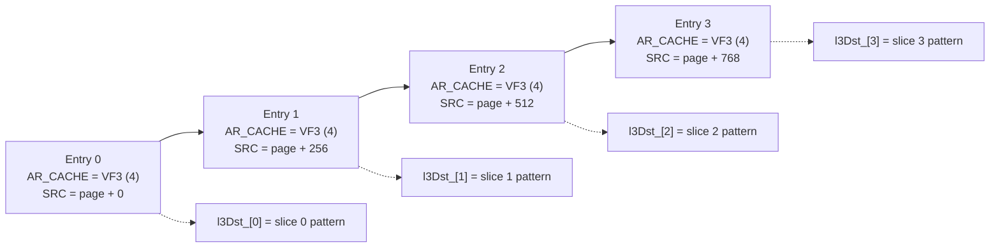

# EN2 Nest and NPU DMAC with MMU: DMAC-MMU-C-01 Multi-Entry Linked List, Translated

Parent issue: #TBD (EN2 Nest and NPU DMAC with MMU Test Plan). Group: P1 sub-issue #TBD.

> **ID convention:** `DMAC-MMU-C-nn` = **C**andidate test (to be written).

| | |
|---|---|
| Runs on | Nest |
| Executable | `test-nest-dmac-mmu-bm.elf` (existing) |
| Source | `tests/common/test-bm/TestDmacMmu.cpp`, as a new `TEST_F_CLEAN` case in `DmacMmuFixture`. No CMake change. |
| Items closed | 4: `DmacLinkedListDesc::getCnt`, `getPoolCnt`, `getLLHead`, and behaviour 13 (multi-entry linked list, translated, one id for the whole list) |
| Coverage | If P1 is done in order (C-01 first): 57.6% to **64.4%** (+6.8%). Final P1 figure is 74.6%. |

## Goal

One linked list with four entries, all from one client (VF3). The list carries one client id, set once before the first `addEntry`. Each entry reads a different 256 B slice of that client's page, so the entries exercise the address progression through the translation. Each entry must return its own slice. This is the first test with more than one entry, and the first to inspect the list.

## Background

- The list carries one id. `setIid` is called once, before the first `addEntry`, and each entry takes that id when it is built. The driver's API is one id per list, so the test does not change the id between entries.
- `applyIid` writes the id into `AR_CACHE` when the source is LPDDR, and into `AW_CACHE` when the destination is LPDDR. The other field keeps the default, 9 (the RISC-V client, which `MmuMemApi::enable()` leaves untranslated).
- When the transfer completes, `handleDescriptorDone` resets the descriptor: `getCnt()` and `getPoolCnt()` return 0, and `getLLHead()` returns null. Check the list **before** dispatch, and check the reset **after**.
- The destination is L3 on purpose. A linked-list write to DDR is GAP-01 (C-14).

## Fixture additions

| Addition | Purpose |
|---|---|
| `llMultiBuffer_[4]` and `llMultiPool_[4]` | A four-entry pool. Place the buffer with `DMAC_TEST_LL_POOL_ATTR`, like `llDescBuffer_`. Fill the pointer array in `setUp`. The existing one-entry pool and `xferLl` stay as they are. |
| `l3Dst_[4]` (256 B each) | Destination buffers, in `.l3_noinit_uncached` as `TestDmacLife.cpp` does, so the core sees DMA writes. |
| `ctlOf(const DmacLLHWDesc *)` | Returns `eai::nriscv::DmacChannel::CH_CTLStruct` built from `CHx_CTL_hi` and `CHx_CTL_lo`, to read `__AR_CACHE` and `__AW_CACHE`. |
| `stampClient(client, va, pattern)` | Fills a client page by a translated L3 to DDR single-block write through `xfer`, as phase one of `UidSweep` does. |

These helpers are shared with C-02, C-03 and C-04. Whichever of those lands first adds them.

**Client:** VF3 (id 4). **Patterns:** slice k holds `0xD0 + k`. `UidSweep` uses `0xC0 +` and the disabled linked-list sweep uses `0xB0 +`, so a page left behind by another test cannot look like a pass.

## Steps

1. Call `selectEngine()` and `initMmu()`. Enable VF3. Allocate one 1 KB allocation for VF3 with `allocate(1024, VF3)`, which takes one page. Note its VA `page`.
2. Split the page into four 256 B slices. Stamp slice k with `0xD0 + k`, translation on, using `stampClient` on each slice's VA (`page + 256 * k`).
3. `linkedListDesc_.init(llMultiPool_, 4)`.
4. Call `setIid(4)` once, before the first `addEntry`. Then, for k = 0 to 3: `addEntry(DDR lo of page + 256 * k, LPDDR hi, l3Dst_[k] lo, L3 hi, 256)`.
5. **Before dispatch**, assert:
    - `getCnt() == 4`, `getPoolCnt() == 4`, and `getLLHead() == &llMultiBuffer_[0]`.
    - Entry k's `CHx_LLP` equals the AXI address of entry k+1 (`ptrToAxiAddrDmac`), and the last entry's LLP is 0.
    - `DmacEngine::checkLastLLElem` is true for entry 3 only.
    - For each entry, `ctlOf(entry).__AR_CACHE` equals 4 (VF3, the list's one id), and `__AW_CACHE == 9`.
6. Fill every `l3Dst_[k]` with `0xFF`. Clear `IRPT_AXI` and `IRPT_LUT`. Dispatch with `pEngine_->xfer(&linkedListDesc_)` and wait for `dmacDone_`. `getChannelError()` must be `NONE`.
7. **After completion**, assert:
    - Every `l3Dst_[k]` holds 256 bytes of `0xD0 + k`.
    - `IRPT_AXI` and `IRPT_LUT` are 0.
    - `getCnt() == 0`, `getPoolCnt() == 0`, and `getLLHead() == nullptr`.
    - Each entry's `CHx_LLP_STATUS_lo` and `_hi` no longer equal the seed `0xF0F0F0F0` that `addEntry` wrote, which shows the entry ran.
8. Do not call `setIid` between entries. The id is set once for the list, and a multi-id list is not a supported use of the API.
9. Free every allocation with `freeClients` on every exit path. `tearDown` turns translation off.

## Pass and failure

**Pass when** every assertion holds. **A failure means:** an entry read the wrong slice (its address was built wrong or the offset was dropped), an entry's id is not the list's id, or the chain or count is wrong.

## Notes

- **Entry write-back.** Step 7 assumes the DMAC writes per-entry status back for entries that finish cleanly. Confirm on hardware, or drop that check.
- **Pool placement.** On the Nest the pool stays in RVSRAM through `DMAC_TEST_LL_POOL_ATTR`. A code comment says the fetch fails from DCCM and L3. That is unverified and is tracked as GAP-03 (C-17).
- **Uncached L3.** `TestDmacMmu.cpp` uses `.l3_noinit` today. Check whether the existing buffers are exposed to stale cache reads.

## Tracking

- [ ] Fixture additions (pool, buffers, `ctlOf`, `stampClient`) in `DmacMmuFixture`
- [ ] DMAC-MMU-C-01 test case

## Definition of done

- Test added, built for EN2 with `ENABLE_EXTRA_METAL`, and passing on target.
- Frees what it allocates, turns translation off and clears `IRPT_AXI` and `IRPT_LUT`.
- Existing `DmacMmu` tests still pass.
- Coverage table in the parent issue updated.
